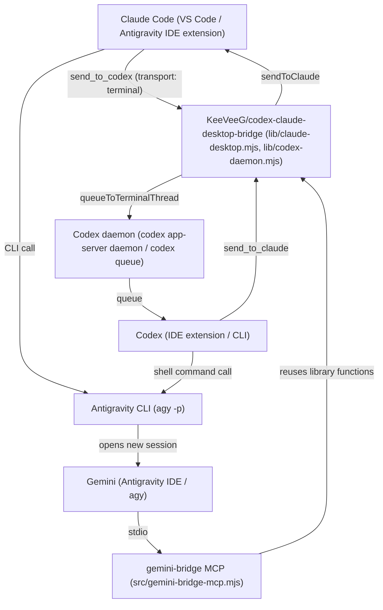

# claude-codex-gemini-bridge

[Tiếng Việt](README.vi.md) | English

Documentation and supporting tools that let three locally running coding agents - Claude Code (Anthropic), Codex (OpenAI), and Gemini (Google, via Antigravity) - message and delegate tasks directly to one another without the user manually forwarding messages through the chat box. In this model, Claude Code acts as the coordinator while also doing its own share of the work, and Codex and Gemini take assigned tasks or cover for each other when one side runs out of quota.

## Tested status

Note upfront: All setup steps, source code, and instructions in this repo have only been tested on a single Windows machine.

Status labels: [VERIFIED] = actually run and observed; [REPORTED] = stated by the maintainer without logs in this repo; [NOT TESTED] = never tried. The Vietnamese originals under `docs/` use the Vietnamese labels (ĐÃ KIỂM = VERIFIED, BÁO CÁO = REPORTED, CHƯA KIỂM = NOT TESTED); the English translations under `docs/en/` use the English ones.

- **Tested environment ([VERIFIED])**: Windows 11 (single machine), Claude Code `2.1.312` (extension running in VS Code and in Antigravity IDE), Codex CLI `0.165.0` (installed via `npm`, with IDE extension), Antigravity CLI `agy` `1.4.10`, Node `24.15`.
- **Untested environments ([NOT TESTED])**: macOS, Linux, other Windows machines, other IDEs, and multi-machine setups. The path to the bridge library has been parameterized (`BRIDGE_LIB_DIR` variable) and the test suite runs on machines without Claude or Codex using a mock library, but the installation instructions (PowerShell, `%LOCALAPPDATA%`, Task Scheduler, `codex.exe`) are still written for Windows. The upstream bridge's claimed macOS support over SSH has also not been tested by us ([NOT TESTED]).

## Communication directions and status

| Direction | Mechanism | Status |
|---|---|---|
| Claude -> Codex | Bridge `send_to_codex` tool, requires setting `transport: "terminal"` | [VERIFIED] |
| Codex -> Claude | Bridge `send_to_claude` tool | [VERIFIED] |
| Gemini -> Claude | `send_to_claude` tool of the `gemini-bridge` MCP (or fallback script) | [VERIFIED] |
| Gemini -> Codex | `send_to_codex` tool of the `gemini-bridge` MCP (goes through `codex queue`) | [VERIFIED], exact timing of when Codex reads the message is unclear |
| Claude -> Gemini | `agy -p` command (opens a new non-interactive Gemini session) | [VERIFIED] |
| Codex -> Gemini | `agy -p` command run via Codex shell command | [VERIFIED] |

General limitations:
- No communication direction provides a read receipt (`acknowledged: false`).
- An already-open Gemini conversation in Antigravity IDE has no inbox for pushed messages; Gemini only receives tasks when invoked via `agy -p` or when it runs a tool itself.

## Architecture overview



## Coordination model and quota exhaustion handling

- **Coordination**: Claude assigns suitable tasks to Codex and Gemini while directly handling parts that require user conversation context, integration, result verification, and all restricted operations (writing to production or shared clusters, reading production DBs, write-capable `kubectl` or `ssh`, handling credentials, irreversible deletion, pushing, sending data externally, or changing agent permission settings).
- **Three collaboration patterns**: parallel task splitting, cross-checking (one agent reviews another agent's output), or sequential pipelines (Gemini researches, Codex or Claude implements, the remaining side reviews).
- **On quota exhaustion**: If Codex or Gemini reports a quota error (initially estimated via keywords `quota`, `usage limit`, `rate limit`, `resource exhausted`, `credits`, or codes `429`, `402`), that task is handed over intact to the remaining agent; if both are out of quota, Claude performs the work itself and informs the user. Quota-exhaustion handoff is currently at the [REPORTED] level (the maintainer reports having used it in practice over two days, but this repo does not have saved logs).

## Directory structure

- `src/`:
  - `src/gemini-bridge-mcp.mjs`: Node `stdio` MCP server (no external dependencies) that provides Gemini with four tools - `list_claude_sessions`, `send_to_claude`, `list_codex_chats`, `send_to_codex` - by calling into the bridge library. [VERIFIED: `npm test` passes on Windows with Node 24.15 (see README, Running tests section); the live send test only runs when `SESSION_ID` and `BRIDGE_LIB_DIR` are manually set].
  - `src/gemini-send-to-claude.mjs`: Fallback CLI script to send a single message to a Claude session when not using MCP.
- `test/`: Automated test suite for `gemini-bridge`; uses a mock bridge library in `test/fixtures/` by default so it can run on machines without Claude or Codex sessions.
- `templates/`: Template block of agent coordination instructions (delimited by HTML tags `dieu-phoi-agent:bat-dau` and `dieu-phoi-agent:ket-thuc`) to be inserted into `<HOME>/.claude/CLAUDE.md`, `<HOME>/.codex/AGENTS.md`, and `<HOME>/.gemini/GEMINI.md`.
- `extras/redact-secrets/`: Optional `PostToolUse` hook for Claude Code that replaces secret strings in tool output with `<REDACTED:kind>`. [VERIFIED: 12/12 tests, run live with PowerShell, Bash, Read, Grep]; [NOT TESTED] with WebFetch, Agent, Glob, and MCP tools.
- `docs/`: Detailed documentation on setup, architecture, troubleshooting, and security. The Vietnamese originals are in `docs/`; the English translations are in `docs/en/`.

## Running tests

```
npm test
```

Requires Node >= 20, with no dependencies to install. Tested with Node 24.15 on Windows (38 tests, 37 passed, 1 skipped). The live message-sending test is skipped unless you manually set `SESSION_ID` and `BRIDGE_LIB_DIR` pointing to a real bridge. The CI workflow in `.github/workflows/test.yml` runs on Ubuntu, Windows and macOS with Node 20 and 22. It ran on 30 Oct 2026, and all 6 combinations passed at least once across two runs on two commits whose code was identical (they differed only in the README). The macOS with Node 22 job was cancelled twice in the first run because GitHub could not allocate a macOS runner (an infrastructure error; the job ran no steps) and passed in the second run. CI only tests logic using the mock library; it does not prove integration with real Claude, Codex or Gemini installations, and the installation instructions have only been tried on Windows.

## Detailed documentation

The Vietnamese documents are the originals (maintained by hand). The English versions in `docs/en/` were translated by Gemini and then cross-checked against the Vietnamese text by Codex and by automated structure checks; if they ever disagree, the Vietnamese original is authoritative. Code comments, error messages, test names and the files under `templates/` are still in Vietnamese.

- Step-by-step installation and configuration guide: [docs/en/SETUP.md](docs/en/SETUP.md) ([Vietnamese](docs/SETUP.md))
- Architecture, message flows, identity, and coordination model: [docs/en/ARCHITECTURE.md](docs/en/ARCHITECTURE.md) ([Vietnamese](docs/ARCHITECTURE.md))
- Real-world errors encountered and how to fix them: [docs/en/TROUBLESHOOTING.md](docs/en/TROUBLESHOOTING.md) ([Vietnamese](docs/TROUBLESHOOTING.md))
- Trust model, permissions, and security: [docs/en/SECURITY.md](docs/en/SECURITY.md) ([Vietnamese](docs/SECURITY.md))
## Credits

This setup is based on the open-source project `KeeVeeG/codex-claude-desktop-bridge` (MIT license) by author KeeVeeG for connecting Claude Code and Codex. Release `v0.4.0` of the upstream bridge only recognized Claude sessions with entrypoints `claude-desktop`, `cli`, `sdk-cli`; support for the VS Code extension (`claude-vscode`) was submitted by us via PR #5 and merged into the `main` branch on `2026-10-29` (merge commit `3ac8488`). Because it is unclear whether a new release tag containing this patch exists yet, users need to install from the `main` branch starting from commit `3ac8488` onward.

This `claude-codex-gemini-bridge` repo **does not contain the source code** of `KeeVeeG/codex-claude-desktop-bridge`, and only documents how to install it and load library functions from the `<bridge directory>/lib/` folder of that project.

## License

This project is released under the MIT license.
