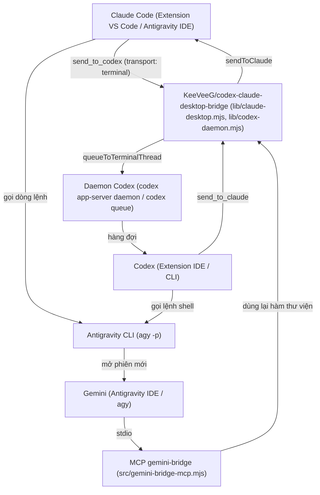

# claude-codex-gemini-bridge

Tiếng Việt | [English](README.md)

Tài liệu và bộ công cụ bổ trợ giúp ba agent lập trình chạy cục bộ gồm Claude Code (Anthropic), Codex (OpenAI) và Gemini (Google, qua Antigravity) nhắn tin và giao việc trực tiếp cho nhau mà không cần người dùng chuyển tiếp thủ công qua khung chat. Trong mô hình này, Claude Code giữ vai trò điều phối và trực tiếp làm phần việc của mình, còn Codex và Gemini nhận các phần việc được phân công hoặc thay thế nhau khi một bên hết quota.

## Tình trạng kiểm nghiệm thực tế

Lưu ý ngay từ đầu: Toàn bộ thiết lập, mã nguồn và hướng dẫn trong repo này mới chỉ được kiểm nghiệm trên một máy Windows duy nhất.

- **Môi trường đã kiểm ([ĐÃ KIỂM])**: Windows 11 (một máy), Claude Code `2.1.312` (extension chạy trong VS Code và trong Antigravity IDE), Codex CLI `0.165.0` (cài bằng `npm`, có extension trong IDE), Antigravity CLI `agy` `1.4.10`, Node `24.15`.
- **Môi trường chưa kiểm ([CHƯA KIỂM])**: macOS, Linux, máy Windows khác, các IDE khác và cấu hình nhiều máy. Đường dẫn tới thư viện của bridge đã được tham số hóa (biến `BRIDGE_LIB_DIR`) và bộ test chạy được trên máy không có Claude hay Codex nhờ thư viện giả, nhưng các hướng dẫn cài (PowerShell, `%LOCALAPPDATA%`, Task Scheduler, `codex.exe`) vẫn viết cho Windows. Tuyên bố hỗ trợ macOS qua SSH của bridge gốc cũng chưa được chúng tôi thử nghiệm ([CHƯA KIỂM]).

## Các chiều liên lạc và trạng thái

| Chiều liên lạc | Cơ chế thực hiện | Trạng thái |
|---|---|---|
| Claude -> Codex | Công cụ `send_to_codex` của bridge, bắt buộc đặt `transport: "terminal"` | [ĐÃ KIỂM] |
| Codex -> Claude | Công cụ `send_to_claude` của bridge | [ĐÃ KIỂM] |
| Gemini -> Claude | Công cụ `send_to_claude` của MCP `gemini-bridge` (hoặc script dự phòng) | [ĐÃ KIỂM] |
| Gemini -> Codex | Công cụ `send_to_codex` của MCP `gemini-bridge` (đi qua `codex queue`) | [ĐÃ KIỂM], chưa rõ thời điểm phía Codex đọc tin |
| Claude -> Gemini | Lệnh `agy -p` (mở một phiên Gemini mới không tương tác) | [ĐÃ KIỂM] |
| Codex -> Gemini | Lệnh `agy -p` chạy qua lệnh shell của Codex | [ĐÃ KIỂM] |

Giới hạn chung:
- Không chiều liên lạc nào có xác nhận đã đọc (`acknowledged: false`).
- Hội thoại Gemini đang mở sẵn trong Antigravity IDE không có hộp thư nhận tin đẩy vào; Gemini chỉ nhận việc khi được gọi bằng `agy -p` hoặc khi tự chạy công cụ.

## Kiến trúc tổng quan



## Mô hình điều phối và xử lý hết quota

- **Điều phối**: Claude phân công việc phù hợp cho Codex và Gemini, đồng thời trực tiếp làm các phần cần ngữ cảnh hội thoại với người dùng, tích hợp, kiểm chứng kết quả và mọi thao tác thuộc nhóm hạn chế (ghi lên production hoặc cụm dùng chung, đọc DB production, `kubectl` hoặc `ssh` có ghi, xử lý credential, xóa không hoàn tác, push, gửi dữ liệu ra ngoài, đổi cấu hình quyền của agent).
- **Ba cách phối hợp**: chia việc song song, chéo kiểm (một agent đọc lại kết quả của agent khác), hoặc nối tiếp (Gemini tra cứu, Codex hoặc Claude cài đặt, bên còn lại review).
- **Khi hết quota**: Nếu Codex hoặc Gemini báo lỗi hết quota (nhận diện ước đoán ban đầu qua các từ khóa `quota`, `usage limit`, `rate limit`, `resource exhausted`, `credits`, hoặc mã `429`, `402`), phần việc đó được chuyển nguyên vẹn cho agent còn lại; nếu cả hai đều hết quota, Claude tự thực hiện và báo cho người dùng. Việc chuyển giao khi hết quota hiện ở mức [BÁO CÁO] (người bảo trì báo cáo đã dùng thật trong hai ngày, nhưng repo này không có nhật ký lưu lại).

## Cấu trúc thư mục

- `src/`:
  - `src/gemini-bridge-mcp.mjs`: Máy chủ MCP giao tiếp qua `stdio` viết bằng Node (không dùng phụ thuộc ngoài), cung cấp cho Gemini bốn công cụ `list_claude_sessions`, `send_to_claude`, `list_codex_chats`, `send_to_codex` bằng cách gọi lại thư viện của bridge. [ĐÃ KIỂM: `npm test` đạt trên Windows với Node 24.15 (xem README, mục Chạy kiểm thử); ca gửi thật chỉ chạy khi tự đặt `SESSION_ID` và `BRIDGE_LIB_DIR`].
  - `src/gemini-send-to-claude.mjs`: Script dòng lệnh dự phòng để gửi một tin tới phiên Claude khi không dùng MCP.
- `test/`: Bộ kiểm thử tự động cho `gemini-bridge`; mặc định dùng thư viện bridge giả trong `test/fixtures/` nên chạy được ở máy không có phiên Claude hay Codex.
- `templates/`: Mẫu khối hướng dẫn điều phối agent (kẹp giữa hai thẻ HTML `dieu-phoi-agent:bat-dau` và `dieu-phoi-agent:ket-thuc`) dùng để chèn vào `<HOME>/.claude/CLAUDE.md`, `<HOME>/.codex/AGENTS.md` và `<HOME>/.gemini/GEMINI.md`.
- `extras/redact-secrets/`: Hook `PostToolUse` tùy chọn cho Claude Code giúp thay thế các chuỗi bí mật trong đầu ra công cụ bằng `<REDACTED:loại>`. [ĐÃ KIỂM: 12/12 test, chạy thật với PowerShell, Bash, Read, Grep]; [CHƯA KIỂM] với WebFetch, Agent, Glob và công cụ MCP.
- `docs/`: Tài liệu chi tiết về cài đặt, kiến trúc, xử lý sự cố và bảo mật.

## Chạy kiểm thử

```
npm test
```

Cần Node >= 20, không có phụ thuộc cần cài. Mới chạy với Node 24.15 trên Windows (38 test, 37 đạt, 1 bỏ qua). Ca gửi tin thật bị bỏ qua trừ khi bạn tự đặt `SESSION_ID` và `BRIDGE_LIB_DIR` trỏ tới bridge thật. Workflow CI trong `.github/workflows/test.yml` (Ubuntu, Windows, macOS với Node 20 và 22) đã chạy ngày 30/10/2026 và cả 6 tổ hợp (Ubuntu, Windows, macOS với Node 20 và 22) đều đạt ít nhất một lần, qua hai lượt chạy trên hai commit chỉ khác nhau ở README (mã giống hệt). Riêng tổ hợp macOS với Node 22 bị hủy hai lần ở lượt đầu vì GitHub không cấp được máy chạy macOS (lỗi hạ tầng, job chưa chạy bước nào) rồi đạt ở lượt sau. CI chỉ kiểm logic bằng thư viện giả, không chứng minh tích hợp với Claude, Codex hay Gemini thật; các hướng dẫn cài đặt vẫn chỉ được thử trên Windows.

## Tài liệu chi tiết

- Hướng dẫn cài đặt và cấu hình từng bước: [docs/SETUP.md](docs/SETUP.md)
- Kiến trúc, luồng tin nhắn, danh tính và mô hình điều phối: [docs/ARCHITECTURE.md](docs/ARCHITECTURE.md)
- Các lỗi thực tế đã gặp và cách khắc phục: [docs/TROUBLESHOOTING.md](docs/TROUBLESHOOTING.md)
- Mô hình tin cậy, phân quyền và bảo mật: [docs/SECURITY.md](docs/SECURITY.md)

## Ghi công

Thiết lập này dựa trên dự án mã nguồn mở `KeeVeeG/codex-claude-desktop-bridge` (giấy phép MIT) của tác giả KeeVeeG để kết nối giữa Claude Code và Codex. Bản phát hành `v0.4.0` của bridge gốc chỉ nhận các phiên Claude có entrypoint `claude-desktop`, `cli`, `sdk-cli`; hỗ trợ cho extension VS Code (`claude-vscode`) đã được chúng tôi gửi qua PR #5 và merge vào nhánh `main` ngày `2026-10-29` (commit merge `3ac8488`). Do chưa rõ đã có tag phát hành mới chứa bản vá này hay chưa, người dùng cần cài từ nhánh `main` tính từ commit `3ac8488` trở đi.

Repo `claude-codex-gemini-bridge` này **không chứa mã nguồn** của `KeeVeeG/codex-claude-desktop-bridge`, mà chỉ hướng dẫn cách cài đặt và nạp lại các hàm thư viện từ thư mục `<thư mục bridge>/lib/` của dự án đó.

## Giấy phép

Dự án này được phát hành theo giấy phép MIT.
