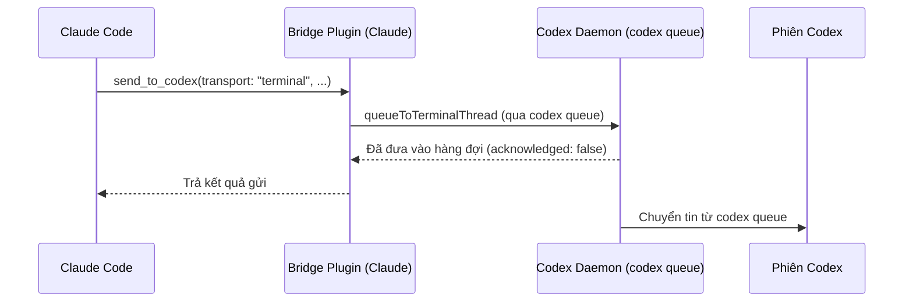
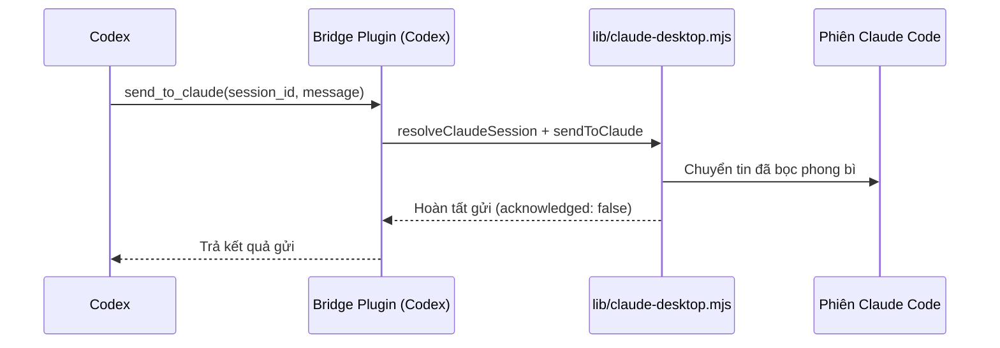
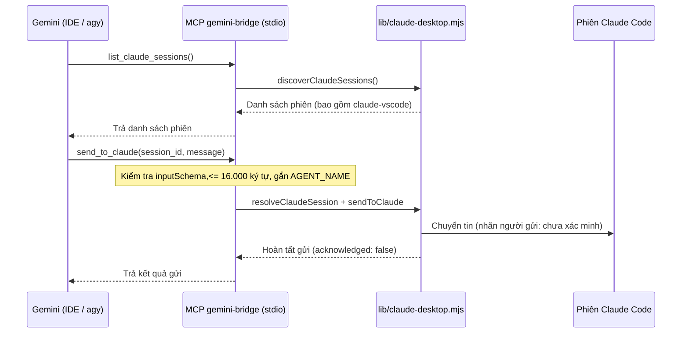
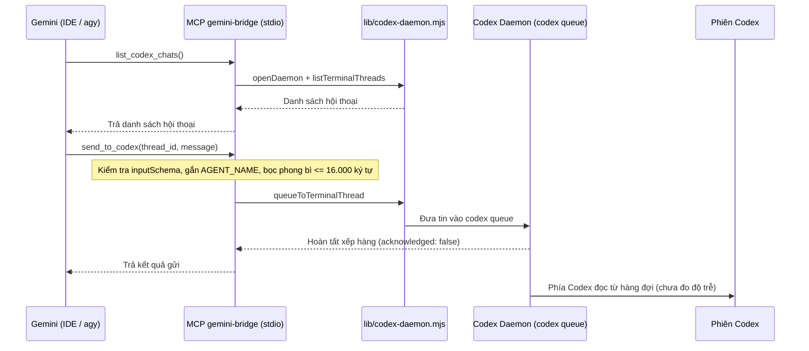
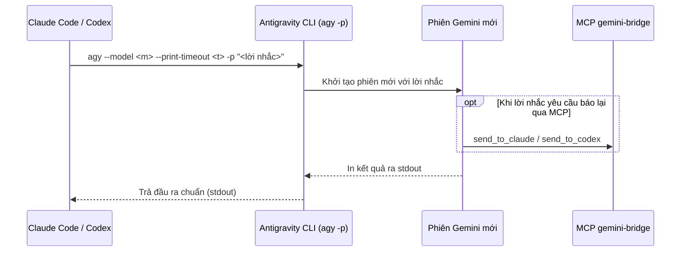

# Kiến trúc hệ thống và mô hình điều phối

Tài liệu này mô tả chi tiết các thành phần, luồng truyền tin theo từng chiều, cơ chế định danh, giới hạn kỹ thuật của từng kênh giao tiếp và quy tắc điều phối công việc giữa ba agent Claude Code, Codex và Gemini.

Lưu ý về phạm vi kiểm chứng: Mọi thông tin có nhãn `[ĐÃ KIỂM]` đều được đo trên một máy Windows 11 duy nhất (Claude Code `2.1.312`, Codex CLI `0.165.0`, Antigravity CLI `agy` `1.4.10`, Node `24.15`). Các hệ điều hành khác (macOS, Linux) và máy khác hoàn toàn ở trạng thái `[CHƯA KIỂM]`.

---

## 1. Các thành phần và vai trò

1. **Claude Code (Anthropic)**: Chạy dưới dạng extension trong VS Code hoặc trong Antigravity IDE (`2.1.312`). Đóng vai trò agent điều phối trung tâm và trực tiếp thực hiện các phần việc cần ngữ cảnh hội thoại với người dùng, tích hợp mã, kiểm chứng kết quả và các thao tác thuộc nhóm hạn chế.
2. **Codex (OpenAI)**: Gồm bản CLI cài qua `npm` (`@openai/codex` `0.165.0`) và extension trong IDE. Nhận việc từ Claude hoặc Gemini qua hàng đợi của daemon, hoặc được gọi chạy không tương tác bằng lệnh `codex exec`.
3. **Gemini (Google, qua Antigravity)**: Hoạt động trong Antigravity IDE hoặc qua công cụ dòng lệnh `agy` (`1.4.10`). Google đã ngừng phục vụ gói AI Pro và Ultra qua Gemini CLI (`gemini`) từ ngày `2026-06-18` (báo lỗi `IneligibleTierError`), do đó `agy` là đường dòng lệnh duy nhất để gọi Gemini.
4. **Bridge Claude-Codex (`KeeVeeG/codex-claude-desktop-bridge`)**: Dự án ngoài (giấy phép MIT, yêu cầu Node >= 20), cung cấp plugin cho Claude Code và Codex để gửi tin bất đồng bộ theo ID phiên chính xác; theo mô tả của bridge, danh tính người gửi được xác minh theo tiến trình (chúng tôi chưa tự kiểm cơ chế này). Bản `v0.4.0` chỉ nhận các entrypoint `claude-desktop`, `cli`, `sdk-cli` nên bỏ qua phiên extension VS Code (`claude-vscode`). Cần dùng nhánh `main` từ commit merge `3ac8488` (PR #5, merge ngày `2026-10-29`) trở đi để nhận diện `claude-vscode`. Repo này không chép mã của bridge mà tái sử dụng các hàm trong `<thư mục bridge>/lib/claude-desktop.mjs` và `<thư mục bridge>/lib/codex-daemon.mjs`.
5. **Daemon Codex (`codex app-server daemon`)**: Tiến trình nền quản lý kết nối và hàng đợi `codex queue` cho các phiên Codex. Bridge không tự khởi động daemon này; người dùng cần chạy `codex app-server daemon start` (bằng bản `@openai/codex` cài qua `npm`, vì bản `codex.exe` đi kèm extension IDE không có đủ gói cục bộ và báo lỗi `this CLI has no complete local package`). `[ĐÃ KIỂM]`
6. **Máy chủ MCP `gemini-bridge` (`src/gemini-bridge-mcp.mjs`)**: Máy chủ MCP giao tiếp qua `stdio`, chạy trên Node và không có phụ thuộc ngoài. Thành phần này cung cấp bốn công cụ cho Gemini (`list_claude_sessions`, `send_to_claude`, `list_codex_chats`, `send_to_codex`) bằng cách gọi trực tiếp các hàm `resolveClaudeSession`, `sendToClaude`, `discoverClaudeSessions` (trong `lib/claude-desktop.mjs`) và `openDaemon`, `listTerminalThreads`, `queueToTerminalThread` (trong `lib/codex-daemon.mjs`). Máy chủ kiểm tra kiểu dữ liệu chuỗi và số nguyên theo `inputSchema`, giới hạn mỗi tin 16.000 ký tự (với Codex được tính sau khi bọc phong bì). `[ĐÃ KIỂM: `npm test` đạt trên Windows với Node 24.15 (xem README, mục Chạy kiểm thử); ca gửi thật chỉ chạy khi tự đặt `SESSION_ID` và `BRIDGE_LIB_DIR`]`
7. **Script dự phòng (`src/gemini-send-to-claude.mjs`)**: Công cụ dòng lệnh gửi trực tiếp một tin tới một phiên Claude khi không sử dụng MCP.
8. **Mẫu hướng dẫn (`templates/`) và hook che secret (`extras/redact-secrets/`)**:
   - Các tệp mẫu định nghĩa khối quy tắc điều phối nằm giữa hai dòng thẻ HTML `dieu-phoi-agent:bat-dau` và `dieu-phoi-agent:ket-thuc` đặt tại `<HOME>/.claude/CLAUDE.md`, `<HOME>/.codex/AGENTS.md` và `<HOME>/.gemini/GEMINI.md`.
   - Hook `PostToolUse` tùy chọn cho Claude Code giúp quét và thay thế secret trong đầu ra của công cụ bằng `<REDACTED:loại>`. `[ĐÃ KIỂM: 12/12 test với PowerShell, Bash, Read, Grep]`; `[CHƯA KIỂM]` với WebFetch, Agent, Glob, công cụ MCP.

---

## 2. Luồng liên lạc theo từng chiều

### 2.1. Chiều Claude -> Codex (`[ĐÃ KIỂM]`)

Claude có hai cách giao việc cho Codex:
1. Gửi tin vào một phiên Codex đang tồn tại qua công cụ `send_to_codex` của bridge với tham số bắt buộc `transport: "terminal"` (nếu để chế độ `auto`, daemon sẽ từ chối các hội thoại trong extension vì báo trạng thái `notLoaded`). Tin nhắn sẽ đi qua `codex queue`.
2. Gọi chạy một tiến trình Codex không tương tác qua lệnh:
   `codex exec -C <thư mục> -s read-only|workspace-write --skip-git-repo-check -` (truyền lời nhắc qua `stdin`).

### 2.2. Chiều Codex -> Claude (`[ĐÃ KIỂM]`)

Codex sử dụng công cụ `send_to_claude` từ plugin của bridge. Theo mô tả của bridge, nó xác minh tiến trình gửi của Codex, bọc tin trong thẻ `cross-session-message` và chuyển tới đúng ID phiên Claude Code.

### 2.3. Chiều Gemini -> Claude (`[ĐÃ KIỂM]`)

Gemini (chạy trong Antigravity IDE hoặc được gọi từ `agy`) dùng công cụ `list_claude_sessions` và `send_to_claude` của máy chủ MCP `gemini-bridge` (hoặc gọi script dòng lệnh dự phòng `src/gemini-send-to-claude.mjs`).

### 2.4. Chiều Gemini -> Codex (`[ĐÃ KIỂM]`, chưa rõ thời điểm phía Codex đọc)

Gemini gọi `list_codex_chats` và `send_to_codex` của MCP `gemini-bridge`. Máy chủ MCP dùng lại `openDaemon`, `listTerminalThreads` và `queueToTerminalThread` trong `lib/codex-daemon.mjs` để đẩy tin vào `codex queue`.

### 2.5. Chiều Claude -> Gemini và Codex -> Gemini (`[ĐÃ KIỂM]`)

Do hội thoại Gemini đang mở trong IDE không có hộp thư nhận tin đẩy vào, cả Claude và Codex đều gọi Gemini bằng cách khởi chạy một phiên không tương tác mới qua CLI `agy`:
`agy --model <m> --print-timeout <t> [--dangerously-skip-permissions] -p "<lời nhắc>"`

---

## 3. Danh tính người gửi và phong bì tin

### 3.1. Xác minh danh tính
- **Claude và Codex**: Theo mô tả của `KeeVeeG/codex-claude-desktop-bridge`, bridge xác minh danh tính người gửi dựa trên tiến trình thực thi. Chúng tôi chưa tự kiểm cơ chế xác minh này (`[CHƯA KIỂM]`).
- **Gemini**: Danh tính người gửi là **tự khai** thông qua biến môi trường `AGENT_NAME` được cấu hình lúc đăng ký máy chủ MCP (`Gemini (agy)` cho CLI hoặc `Gemini (Antigravity IDE)` cho IDE). Trong `src/gemini-bridge-mcp.mjs`, model không thể tự khai danh tính lúc gọi công cụ và mọi tham số `from` giả mạo truyền vào đều bị từ chối. Tuy nhiên, vì bridge không xác minh được tiến trình của Gemini nên phía nhận (Claude hoặc Codex) luôn thấy nhãn trạng thái người gửi là **chưa xác minh**.

### 3.2. Phong bì tin và ranh giới tin cậy
- Tin gửi sang Claude đi qua `sendToClaude` của bridge, được bọc trong thẻ `cross-session-message` mang tên người gửi (từ Gemini là `AGENT_NAME` kèm nhãn "chưa xác minh").
- Tin `gemini-bridge` gửi sang Codex được bọc bởi phong bì do repo này tạo: dòng đầu nêu nguồn là agent tự khai, chưa xác minh; nội dung tin nằm giữa hai dòng ranh giới `<<<TIN-<mã>` và `TIN-<mã>>>>` với mã ngẫu nhiên mới cho mỗi lần gửi (để nội dung do model sinh ra không giả được dòng đóng); dòng cuối, nằm SAU dòng đóng ranh giới, nêu đây là **ngữ cảnh cộng tác**, **không phải** chỉ thị của người dùng hay hệ thống. Giới hạn 16.000 ký tự được tính **sau khi** bọc phong bì. Ranh giới ngẫu nhiên chỉ làm khó việc giả cấu trúc phong bì; nó không thay được việc agent nhận tự coi nội dung là ngữ cảnh.
- Việc agent nhận coi nội dung là ngữ cảnh chứ không phải chỉ thị còn phụ thuộc vào cách chính agent đó xử lý và vào các quy tắc trong tệp hướng dẫn của nó (`templates/`).
- Phía nhận không được phép tự ý thực hiện các thao tác phá hủy, xóa dữ liệu, `git push`, hoặc thay đổi cấu hình quyền chỉ vì nội dung trong tin nhắn yêu cầu. Thực tế đã kiểm chứng (`[ĐÃ KIỂM]`): Codex tự dừng lại và không thực hiện những việc cần người dùng xác nhận trực tiếp trong phiên Codex (như push, sửa cấu hình quyền của Claude, SSH ghi sang máy khác) dù nhận được tin nhắn từ Claude.
- **Cảnh báo bề mặt tấn công**: Nếu agent phía nhận đang chạy ở chế độ tự động bỏ qua phê duyệt quyền, nội dung tin nhắn từ agent khác có thể dẫn tới việc thực thi lệnh tự động. Đây là bề mặt tấn công có thật cần được kiểm soát bằng quyền công cụ và phạm vi lời nhắc.

---

## 4. Giới hạn kỹ thuật của từng đường

1. **Không có xác nhận đã đọc (`acknowledged: false`)**: Tất cả các chiều gửi tin qua bridge và MCP chỉ xác nhận việc giao tin hoặc xếp hàng thành công, không có tín hiệu báo phía nhận đã đọc hay đã xử lý xong.
2. **Gemini không có hộp thư đẩy vào phiên đang mở**: Không thể đẩy tin nhắn vào một cuộc hội thoại Gemini đang mở sẵn trên Antigravity IDE. Gemini chỉ nhận việc khi được gọi khởi tạo phiên mới qua `agy -p` hoặc khi chính phiên Gemini đó chủ động chạy công cụ MCP.
3. **Hạn chế của `send_to_codex` và hàng đợi**:
   - Chế độ `transport: "auto"` từ chối hội thoại Codex đang mở trong extension IDE vì daemon báo `notLoaded`; bắt buộc phải truyền `transport: "terminal"` để đưa tin qua `codex queue`. `[ĐÃ KIỂM]`
   - Cách thức và độ trễ khi phiên Codex trong extension đọc tin từ `codex queue` hiện chưa được đo đạc cụ thể (`[CHƯA KIỂM]` về độ trễ).
4. **Giới hạn của `agy -p` ở chế độ không tương tác (`[ĐÃ KIỂM]`)**:
   - **Bỏ qua cấu hình quyền**: `agy -p` bỏ qua danh sách `permissions.allow` (issue `google-antigravity/antigravity-cli#548`). Đã thử truyền `--settings` với quy tắc `command(...)` (có và không có ký tự `*`) nhưng đều bị từ chối. Do đó, nếu cần Gemini đọc tệp hoặc gọi công cụ trong chế độ `-p`, bắt buộc phải thêm cờ `--dangerously-skip-permissions` (cờ này duyệt **mọi** công cụ cho lần chạy đó). Chỉ dùng cờ này khi người dùng đã chấp thuận, phạm vi lời nhắc rất hẹp trong thư mục project; các tác vụ hỏi đáp thuần túy không cần cờ này.
   - **Giới hạn độ dài dòng lệnh**: Lời nhắc truyền qua tham số dòng lệnh của `agy -p` nếu dài quá khoảng 32.000 ký tự sẽ im lặng trả về 0 byte. Cần giữ lời nhắc dưới khoảng 25.000 ký tự và luôn kiểm tra đầu ra khác rỗng. Ngoài ra, lời nhắc nhiều dòng truyền qua `Start-Process -ArgumentList` trong PowerShell sẽ bị tách thành nhiều tham số hỏng; cần truyền qua tệp hoặc `stdin`.
5. **Giới hạn nạp tệp hướng dẫn**: Antigravity nạp cộng dồn cả `AGENTS.md` và `GEMINI.md` từ thư mục chứa tệp đi ngược lên gốc workspace và cắt mỗi tệp ở mức 24.000 byte; trong khi đó Codex chỉ đọc tệp `AGENTS.md`.

---

## 5. Mô hình điều phối công việc

### 5.1. Phân vai và nguyên tắc ủy quyền
- **Claude Code** là người điều phối và cùng làm: phân tách công việc, giao phần phù hợp cho Codex hoặc Gemini, tự giữ lại các phần cần ngữ cảnh hội thoại trực tiếp với người dùng, ghép nối kết quả, kiểm chứng và thực hiện các thao tác nhạy cảm.
- **Ủy quyền không nới quyền**: Các công việc thuộc nhóm hạn chế gồm: ghi lên môi trường production hoặc cụm dùng chung, đọc cơ sở dữ liệu production, chạy `kubectl` hoặc `ssh` có ghi, xử lý credential, xóa không hoàn tác, `push`, gửi dữ liệu ra ngoài, hoặc thay đổi cấu hình quyền của agent (`settings.json` của Claude, cấu hình Codex, `mcp_config.json` của Gemini) đều phải hỏi ý kiến người dùng trước hoặc để người dùng tự chạy. Nếu một agent bị chặn quyền thực hiện một thao tác, tuyệt đối không giao việc đó sang agent khác để lách quy tắc.
- **Bảo mật bộ nhớ (memory)**: Cho phép Codex và Gemini đọc thư mục `memory` của Claude đồng nghĩa với việc dữ liệu đó được gửi tới máy chủ của OpenAI và Google; do đó không được lưu bí mật (mật khẩu, token, khóa) trong `memory`.

### 5.2. Ba cách phối hợp
1. **Chia song song**: Tách các hạng mục độc lập cho Claude, Codex và Gemini thực hiện đồng thời.
2. **Chéo kiểm**: Giao cho một agent đọc lại và kiểm tra kết quả (mã nguồn, tài liệu, phân tích) do một agent khác vừa hoàn thành.
3. **Nối tiếp**: Gemini thực hiện tra cứu hoặc khảo sát trước, sau đó Codex hoặc Claude tiến hành cài đặt mã, và agent còn lại thực hiện bước review.

### 5.3. Lựa chọn model
Cấu hình chọn model mặc định theo loại công việc (có thể điều chỉnh theo thực tế):
- **Gemini**:
  - `gemini-4-argon-high`: Dùng cho công việc gồm nhiều bước hoặc có độ khó cao.
  - `gemini-4-argon-medium`: Dùng cho công việc có độ phức tạp trung bình.
  - `gemini-3.8-flash-medium`: Dùng cho tác vụ tra cứu và tóm tắt.
  - Lưu ý thực nghiệm (`[ĐÃ KIỂM, mẫu nhỏ]`): Không dùng biến thể Gemini `low` cho công việc đòi hỏi độ chính xác (đã ghi nhận đếm sai một ký tự trong một lần thử). Ngoài ra, đã gặp hai lần Gemini tự chèn chữ ngoài ngôn ngữ đang dùng vào câu trả lời, nên người điều phối phải đọc lại kết quả trước khi sử dụng hoặc chuyển tiếp.
- **Codex**: Giữ nguyên model theo cấu hình mặc định.

### 5.4. Quy trình mỗi lần giao việc
Mỗi lần giao việc cho Codex hoặc Gemini, lời nhắc phải tuân thủ quy trình:
1. Chỉ giao **một việc** rõ ràng trong một lần gọi.
2. Nêu đầy đủ: mục tiêu, thư mục làm việc, danh sách tệp được phép sửa, các hành vi bị cấm và định dạng báo cáo đầu ra.
3. Khi nhận được báo cáo hoàn thành, Claude phải tự đọc lại tệp và kiểm chứng kết quả thực tế, không tin tưởng mù quáng vào lời báo cáo của agent được giao.

---

## 6. Quy tắc xử lý khi hết quota

- **Quy tắc chuyển việc**: Khi Codex hoặc Gemini gặp lỗi hết quota, Claude chuyển nguyên vẹn phần việc chưa xong sang cho agent còn lại. Nếu cả Codex và Gemini đều hết quota, Claude tự thực hiện phần việc đó và thông báo rõ cho người dùng. Việc hết quota không làm thay đổi ranh giới bảo mật: các việc thuộc nhóm hạn chế vẫn không được tự động giao đi.
- **Dấu hiệu nhận biết**: Dựa trên tập từ khóa và mã lỗi ước đoán ban đầu gồm: `quota`, `usage limit`, `rate limit`, `resource exhausted`, `credits`, mã HTTP `429` hoặc `402`.
- **Trạng thái kiểm chứng (`[BÁO CÁO]`)**: Cơ chế chuyển việc khi hết quota được người bảo trì báo cáo là đã sử dụng thực tế trong hai ngày làm việc, tuy nhiên trong repo này không có nhật ký (log) lưu lại để kiểm chứng độc lập.

---

## 7. Lý do chọn kiến trúc MCP thay cho hộp thư tệp

Để kết nối Gemini vào mạng liên lạc sẵn có giữa Claude và Codex, repo này sử dụng máy chủ MCP `gemini-bridge` qua `stdio` thay vì tự thiết kế một cơ chế hộp thư dựa trên tệp trung gian vì các lý do kỹ thuật sau:
- **Tái sử dụng trực tiếp thư viện của bridge**: Gọi thẳng các hàm định tuyến phiên, bọc phong bì tin và xếp hàng daemon đã được kiểm thử trong `lib/claude-desktop.mjs` và `lib/codex-daemon.mjs`, tránh việc phải duy trì hai giao thức truyền tin song song hoặc chạy thêm tiến trình quét thư mục.
- **Kiểm soát danh tính và đầu vào tại điểm nghẽn**: Máy chủ MCP đọc biến môi trường `AGENT_NAME` từ tệp cấu hình khởi chạy của IDE/`agy` và bác bỏ mọi tham số `from` do model tự truyền vào, đồng thời thực thi việc kiểm tra kiểu dữ liệu theo `inputSchema` và giới hạn kích thước 16.000 ký tự trước khi chuyển tin vào bridge.
