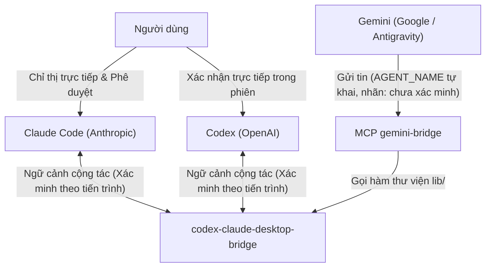

# Chính sách và Mô hình Bảo mật (Security)

Tài liệu này mô tả mô hình tin cậy, bề mặt tấn công, các quy tắc an toàn khi vận hành `claude-codex-gemini-bridge` và cách báo cáo lỗ hổng bảo mật. Mọi thông tin kiểm chứng thực tế (`[ĐÃ KIỂM]`) trong tài liệu này được thực hiện trên Windows 11; các hệ điều hành và môi trường khác hiện ở trạng thái `[CHƯA KIỂM]`.

## 1. Mô hình tin cậy

### 1.1. Xác minh danh tính người gửi

- Giữa Claude và Codex: theo mô tả của bridge (`KeeVeeG/codex-claude-desktop-bridge`), danh tính người gửi được xác minh dựa theo tiến trình thực thi. Đây là điều bridge tuyên bố; repo này chưa tự kiểm cơ chế xác minh đó (`[CHƯA KIỂM]`), chỉ kiểm rằng tin đi đúng hai chiều.
- Từ phía Gemini (`src/gemini-bridge-mcp.mjs`):
  - Tên người gửi được lấy từ biến môi trường `AGENT_NAME` thiết lập lúc đăng ký máy chủ MCP. Model không thể tự khai báo tên lúc gọi công cụ và mọi tham số `from` giả mạo truyền vào đều bị từ chối (`[ĐÃ KIỂM]`).
  - Tuy nhiên, vì `AGENT_NAME` là giá trị tự khai trong cấu hình MCP nên bridge không xác minh được danh tính theo tiến trình; phía nhận luôn nhìn thấy nhãn "chưa xác minh".
- Ràng buộc dữ liệu ở `gemini-bridge`:
  - Giới hạn độ dài tin nhắn tối đa là 16.000 ký tự (đối với Codex, giới hạn này được tính sau khi đã bọc phong bì).
  - Các tham số đầu vào (chuỗi và số nguyên) được kiểm tra chặt chẽ theo `inputSchema` (`[ĐÃ KIỂM]`: `npm test` đạt trên Windows với Node 24.15).

### 1.2. Bản chất của tin nhắn liên agent

- Tin nhắn nhận được từ agent khác chỉ là ngữ cảnh cộng tác, KHÔNG phải chỉ thị của người dùng hay chỉ thị của hệ thống. Với tin `gemini-bridge` gửi sang Codex, phong bì do repo này tạo ra nêu rõ điều đó bằng một câu cuối tin, đặt sau dòng đóng ranh giới ngẫu nhiên của mỗi lần gửi. Với tin gửi sang Claude, bridge bọc tin trong thẻ `cross-session-message` có tên người gửi (kèm nhãn "chưa xác minh" khi từ Gemini); việc Claude Code coi nội dung đó là tin của agent khác chứ không phải của người dùng do chính Claude Code xử lý, repo này không kiểm soát được.
- Phía nhận không được thực hiện các hành động phá hủy, xóa dữ liệu, `push`, hoặc thay đổi cấu hình quyền chỉ vì nội dung một tin nhắn yêu cầu.
- Trong phiên Codex, những việc cần người dùng xác nhận trực tiếp (như `push`, sửa cấu hình quyền của Claude, SSH ghi sang máy khác) sẽ khiến Codex dừng lại chờ người dùng; tin nhắn từ Claude không thay thế xác nhận đó (`[ĐÃ KIỂM]`).

## 2. Bề mặt tấn công

- Thực thi tự động khi tắt phê duyệt: Tin nhắn gửi giữa các agent có thể dẫn tới việc thực thi lệnh tự động nếu agent phía nhận đang chạy ở chế độ bỏ qua phê duyệt quyền. Đây là bề mặt tấn công thật.
- Lan truyền chỉ thị qua ngữ cảnh (prompt injection gián tiếp): Khi một agent đọc nội dung bên ngoài hoặc kết quả từ agent khác rồi chuyển tiếp qua bridge, nội dung độc hại có thể tác động lên agent nhận nếu không có ranh giới quyền hạn.
- Danh tính tự khai của kênh MCP cục bộ: Bất kỳ tác nhân nào chỉnh sửa được biến `AGENT_NAME` lúc khởi tạo MCP đều có thể đặt nhãn tên gửi đi (dù phía nhận vẫn gắn nhãn "chưa xác minh").

## 3. Cờ nguy hiểm: --dangerously-skip-permissions

Khi gọi `agy -p` ở chế độ không tương tác, CLI này bỏ qua cấu hình `permissions.allow` (issue `google-antigravity/antigravity-cli#548`). Các thử nghiệm dùng cờ `--settings` với quy tắc `command(...)` (có và không có dấu `*`) đều bị từ chối (`[ĐÃ KIỂM]`). Do đó, để Gemini đọc tệp hoặc gọi công cụ qua `agy -p`, phải truyền cờ `--dangerously-skip-permissions`.

Rủi ro và điều kiện sử dụng bắt buộc:
- Tác động: Cờ `--dangerously-skip-permissions` tự động duyệt MỌI công cụ cho lần chạy đó mà không hỏi người dùng.
- Chỉ sử dụng cờ này khi người dùng đã chấp thuận.
- Không dùng cờ này cho các tác vụ hỏi đáp thuần túy (hỏi đáp thuần không cần cờ).
- Chỉ dùng với lời nhắc rất hẹp, giới hạn phạm vi hoạt động trong thư mục project.
- Mỗi lần giao việc phải nêu rõ mục tiêu, thư mục, tệp được phép sửa, các việc cấm và định dạng báo cáo.
- Sau khi lệnh chạy xong, agent điều phối (Claude) hoặc người dùng phải tự đọc lại kết quả bằng mắt, không tin vào lời báo cáo của Gemini.

## 4. Nhóm việc hạn chế và nguyên tắc ủy quyền

Nguyên tắc cốt lõi: Ủy quyền không nới quyền. Việc chia sẻ công việc giữa ba agent không làm giảm mức độ kiểm soát đối với các thao tác nhạy cảm.

Danh sách nhóm việc hạn chế:
- Ghi lên môi trường production hoặc cụm dùng chung.
- Đọc cơ sở dữ liệu (DB) production.
- Chạy lệnh `kubectl` hoặc `ssh` có thao tác ghi sang máy khác.
- Xử lý credential (mật khẩu, token, khóa bí mật).
- Xóa dữ liệu không thể hoàn tác.
- Thực hiện `push` hoặc publish mã nguồn/gói.
- Gửi dữ liệu ra ngoài phạm vi cho phép.
- Thay đổi cấu hình quyền của bất kỳ agent nào.

Quy tắc bắt buộc đối với nhóm việc hạn chế:
- Phải hỏi ý kiến người dùng trước hoặc để người dùng tự chạy trực tiếp.
- Tình trạng hết quota KHÔNG làm cho các việc trong nhóm hạn chế này được phép giao sang cho agent khác.
- Nếu một agent bị chặn bởi chính sách quyền, phải dừng và báo cáo; tuyệt đối không giao việc đó cho agent khác để lách quyền.

## 5. Rủi ro khi cho agent đọc memory

- Khi cho phép Codex và Gemini đọc các tệp "memory" của Claude (ví dụ các tệp trong thư mục memory của project), toàn bộ nội dung được đọc sẽ được truyền tới dịch vụ của OpenAI (qua Codex) và Google (qua Gemini / Antigravity).
- Quy tắc bảo vệ dữ liệu:
  - Không đặt bất kỳ bí mật nào (mật khẩu, token, khóa riêng tư, thông tin nhạy cảm) vào trong memory.
  - Các agent chỉ được phép đọc memory, không được sửa, xóa hay đổi tên tệp memory, và không được chép bí mật ra tin nhắn, nhật ký (log) hay tệp.

## 6. Vai trò và giới hạn của hook che secret

Repo cung cấp thành phần tùy chọn tại `extras/redact-secrets/` dùng làm hook `PostToolUse` cho Claude Code:
- Vai trò: Quét đầu ra của công cụ và thay thế các chuỗi khớp mẫu secret bằng `<REDACTED:loại>`. Hook được cấu hình chạy trực tiếp qua `command` + `args` (không qua shell) với `timeout` là 15 giây.
- Phạm vi đã kiểm (`[ĐÃ KIỂM]`): Đạt 12/12 bài test tự động; đã chạy thật với các công cụ `PowerShell`, `Bash`, `Read`, `Grep`.
- Giới hạn chưa kiểm (`[CHƯA KIỂM]`): Chưa kiểm thử với các công cụ `WebFetch`, `Agent`, `Glob` và các công cụ MCP. Vì vậy, đây chỉ là lớp giảm thiểu rủi ro bổ sung, không phải rào chắn bảo đảm chặn mọi rò rỉ secret trên mọi công cụ.
- Quy tắc chống hỏng dữ liệu: Khi hook này hoạt động, tuyệt đối không ghi lại chuỗi `<REDACTED:...>` vào tệp và không dùng nội dung đã bị che để ghi đè toàn bộ tệp.

Các loại secret hook nhận diện (theo mã `extras/redact-secrets/redact-secrets.mjs`): khóa riêng PEM (kể cả khối thiếu dòng END), khóa truy cập AWS, token GitHub, GitLab, npm, Slack, Stripe và bot Telegram, khóa API của Google, OpenAI và Anthropic, JWT, thông tin Bearer và Basic, mật khẩu trong URL, trong chuỗi JDBC và trong đối số `curl -u` hoặc `--user`, giá trị gán cho tên khóa nhạy cảm trong văn bản (ví dụ `password=...`, `api_key: ...`), và giá trị `data` hoặc `stringData` của Secret Kubernetes dạng YAML hoặc JSON. Mỗi quy tắc có điều kiện về định dạng, độ dài hoặc danh sách loại trừ, nên không bảo đảm bắt được mọi giá trị thuộc các nhóm này.

Hai giới hạn đã thấy trong mã:
- Hook duyệt từng giá trị chuỗi của kết quả công cụ mà không biết tên khóa chứa nó. Với một công cụ trả về đối tượng có trường tên `password` và giá trị là chuỗi trần, giá trị đó không bị che; chỉ khi chuỗi tự mang dạng `password=...` hoặc nằm trong văn bản JSON thì mới bị che. Kết quả của Bash, Read, Grep, PowerShell là chuỗi văn bản nên ít bị ảnh hưởng; kết quả có cấu trúc của công cụ MCP có thể bị.
- Hook ghi nhật ký cục bộ `redact-secrets.log` với tên công cụ, loại và số lượng đã che. Nhánh báo lỗi chỉ ghi tên loại lỗi, không ghi nội dung thông báo (thông báo của `JSON.parse` có thể chứa một đoạn đầu vào; đây là lỗi đã gặp và sửa).

Đơn vị đếm của giới hạn 16.000 ký tự là đơn vị mã UTF-16 của JavaScript (`.length`), không phải byte và không phải ký tự Unicode: một ký tự ngoài mặt phẳng cơ bản (như nhiều emoji) tính là 2.
## 7. Khuyến nghị cấu hình quyền

1. Sao lưu và kiểm tra cú pháp:
   - Mọi thao tác chỉnh sửa tệp cấu hình quyền của agent (`<HOME>/.claude/settings.json` của Claude, cấu hình của Codex, `<HOME>/.gemini/config/mcp_config.json` và `<HOME>/.gemini/antigravity/mcp_config.json` của Gemini) đều phải tạo bản sao lưu trước khi sửa và kiểm tra JSON hợp lệ trước khi áp dụng.
2. Cấp quyền tối thiểu:
   - Trong `<HOME>/.claude/settings.json`, chỉ thêm đúng quy tắc `mcp__plugin_codex-claude-desktop-bridge_codex-claude-desktop-bridge__send_to_codex` vào `permissions.allow`.
   - Khi gọi Codex không tương tác bằng `codex exec`, luôn chỉ định rõ thư mục qua `-C <thư mục>` và giới hạn sandbox bằng `-s read-only` hoặc `-s workspace-write`.
3. Duy trì mẫu hướng dẫn điều phối:
   - Đặt khối hướng dẫn từ `templates/` vào cả ba tệp `<HOME>/.claude/CLAUDE.md`, `<HOME>/.codex/AGENTS.md`, `<HOME>/.gemini/GEMINI.md` để các quy tắc về phạm vi, nhóm việc hạn chế và kiểm chứng chéo luôn được nạp trong mọi project.

## 8. Báo cáo lỗ hổng bảo mật

Nếu phát hiện lỗi hoặc lỗ hổng bảo mật trong repo này, vui lòng không mở issue công khai có chứa chi tiết khai thác. Hãy gửi báo cáo trực tiếp qua tính năng GitHub Security Advisories của repo `claude-codex-gemini-bridge`.
