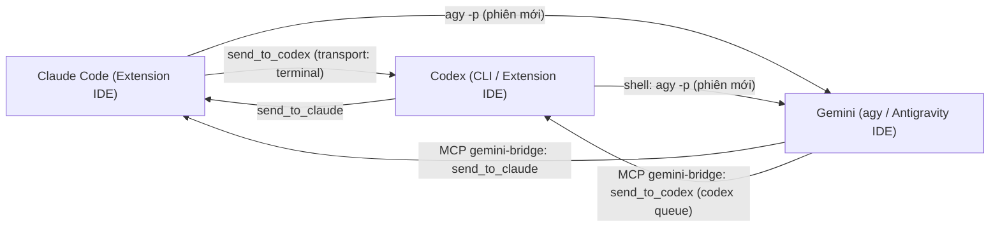

# Hướng dẫn cài đặt claude-codex-gemini-bridge

Tiếng Việt | [English](en/SETUP.md)

Tài liệu này hướng dẫn cài đặt hệ thống kết nối ba agent lập trình chạy cục bộ: Claude Code (Anthropic), Codex (OpenAI) và Gemini (Google, qua Antigravity). Trong mô hình này, Claude là agent điều phối và trực tiếp làm việc; Codex và Gemini nhận phần việc được giao hoặc nhận việc chuyển tiếp khi một bên hết quota.

## Sơ đồ liên lạc tổng quan



## 1. Điều kiện cần và phạm vi môi trường

Cấu hình duy nhất đã kiểm thực tế (`[ĐÃ KIỂM]`):
- Hệ điều hành: Windows 11 (trên một máy), sử dụng PowerShell.
- Node.js: phiên bản `24.15` (bridge yêu cầu Node `>= 20`).
- Claude Code: phiên bản `2.1.312` (extension chạy trong VS Code và trong Antigravity IDE).
- Codex CLI: phiên bản `0.165.0` (cài bằng `npm`, có extension trong IDE).
- Antigravity CLI (`agy`): phiên bản `1.4.10`.

Cảnh báo về hệ điều hành và môi trường khác:
- Các hệ điều hành macOS, Linux, máy Windows khác hoặc IDE khác đều ở trạng thái `[CHƯA KIỂM]`.
- Đường dẫn tới thư viện của bridge trong repo này đã tham số hóa (`BRIDGE_LIB_DIR`), nhưng các lệnh cài đặt dưới đây viết cho Windows. Bridge gốc có tuyên bố hỗ trợ macOS qua SSH nhưng tính năng đó `[CHƯA KIỂM]` trong phạm vi tài liệu này.
- Mọi bước bên dưới có dùng lệnh PowerShell, đường dẫn kiểu Windows (`~`, `%LOCALAPPDATA%`, `codex.exe`, `agy.exe`) và Task Scheduler đều mới chỉ được thực hiện trên Windows và `[CHƯA KIỂM]` ở hệ điều hành khác.

## 2. Cài đặt bridge của KeeVeeG (Claude <-> Codex)

Repo này không chứa mã của bridge Claude-Codex mà hướng dẫn cài đặt và tái sử dụng các hàm từ repo `KeeVeeG/codex-claude-desktop-bridge` (giấy phép MIT, yêu cầu Node `>= 20`).

Lưu ý về phiên bản bridge:
- Bản `v0.4.0` chỉ nhận các phiên Claude có entrypoint là `claude-desktop`, `cli`, `sdk-cli`, do đó bỏ qua phiên của extension VS Code (`claude-vscode`).
- Bản vá bổ sung `claude-vscode` (PR #5) đã được merge vào nhánh `main` ngày 2026-10-29 (commit merge `3ac8488`).
- Chưa rõ đã có bản phát hành (tag) nào chứa bản vá này hay chưa, vì vậy cần lấy mã từ nhánh `main` từ commit `3ac8488` trở đi.

### 2.1. Tải mã nguồn và chạy kiểm thử

Lệnh thực hiện (đã chạy trên Windows PowerShell, hệ điều hành khác `[CHƯA KIỂM]`):

```powershell
git clone https://github.com/KeeVeeG/codex-claude-desktop-bridge <thư mục bridge>
cd <thư mục bridge>
```

Khi chạy bộ test gốc bằng `npm test`, cần đặt biến môi trường `CODEX_CLAUDE_BRIDGE_DAEMON=off` để không tác động tới daemon thật.

- Ghi vào đâu: Tạo thư mục `<thư mục bridge>` trên đĩa.
- Cách hoàn tác: Xóa thư mục `<thư mục bridge>`.

### 2.2. Cài đặt phía Codex

Yêu cầu lệnh `codex` đã chạy được (xem Mục 3 nếu chưa cài `@openai/codex`). Từ `<thư mục bridge>`, chạy:

```powershell
node scripts/install.mjs --codex
```

Kiểm tra sau khi cài:

```powershell
codex plugin list
```

Kết quả cần có dòng `codex-claude-desktop-bridge@personal installed, enabled` (`[ĐÃ KIỂM]`).

- Ghi vào đâu (theo cấu trúc trên Windows, hệ điều hành khác `[CHƯA KIỂM]`):
  - Chép plugin vào `<HOME>\plugins\codex-claude-desktop-bridge` (`~\plugins\codex-claude-desktop-bridge`).
  - Sửa tệp `<HOME>\.agents\plugins\marketplace.json` (`~\.agents\plugins\marketplace.json`), script tự động tạo bản sao lưu trước khi sửa.
  - Thực thi lệnh `codex plugin add codex-claude-desktop-bridge@personal`.
- Cách hoàn tác:
  - Khôi phục tệp `<HOME>\.agents\plugins\marketplace.json` từ bản sao lưu do script tạo ra.
  - Xóa thư mục `<HOME>\plugins\codex-claude-desktop-bridge`.
  - Gỡ plugin `codex-claude-desktop-bridge@personal` khỏi danh sách plugin của Codex.

### 2.3. Cài đặt phía Claude (cài tay và cấp quyền)

Bước 1: Chạy script chuẩn bị từ `<thư mục bridge>`:

```powershell
node scripts/install.mjs --claude
```

Script này chuẩn bị các tệp và đăng ký marketplace nhưng sẽ dừng và báo lỗi ở bước `claude plugin install ... --json` vì CLI `claude` không có tùy chọn `--json` (`[ĐÃ KIỂM]`).

Bước 2: Cài đặt plugin bằng tay:

```powershell
claude plugin install codex-claude-desktop-bridge@codex-claude-desktop-local --scope user
```

Kiểm tra danh sách plugin:

```powershell
claude plugin list
```

Bước 3: Cấp quyền công cụ trong `<HOME>/.claude/settings.json` (`~/.claude/settings.json`):
- Tạo bản sao lưu của tệp `<HOME>/.claude/settings.json` trước khi sửa.
- Mở `<HOME>/.claude/settings.json`, thêm vào mảng `permissions.allow` đúng một quy tắc sau (tương đương việc hàm `grantClaudeSendPermission()` của trình cài thực hiện):

```json
"mcp__plugin_codex-claude-desktop-bridge_codex-claude-desktop-bridge__send_to_codex"
```

- Kiểm tra cú pháp JSON hợp lệ trước khi lưu tệp.

Bước 4: Nạp lại plugin:
- Chạy lệnh `/reload-plugins` trong phiên Claude hoặc mở một phiên Claude mới.
- Kiểm tra bằng cách gọi hai công cụ `list_claude_sessions` và `bridge_doctor` (`[ĐÃ KIỂM]`).

- Ghi vào đâu:
  - Cấu hình marketplace và plugin của Claude ở phạm vi `user`.
  - Tệp `<HOME>/.claude/settings.json`.
- Cách hoàn tác:
  - Khôi phục `<HOME>/.claude/settings.json` từ bản sao lưu (hoặc xóa quy tắc `mcp__plugin_codex-claude-desktop-bridge_codex-claude-desktop-bridge__send_to_codex` khỏi `permissions.allow` và kiểm tra lại JSON).
  - Gỡ plugin `codex-claude-desktop-bridge@codex-claude-desktop-local` khỏi Claude rồi chạy `/reload-plugins` hoặc mở phiên mới.

### 2.4. Các biến môi trường của bridge

- `CODEX_CLAUDE_BRIDGE_CODEX_BIN`: Đường dẫn trực tiếp tới tệp thực thi `codex.exe` nếu không nằm trong `PATH` (tên tệp `.exe` là theo Windows; hệ điều hành khác `[CHƯA KIỂM]`).
- `CODEX_CLAUDE_BRIDGE_DAEMON=off`: Tắt việc sử dụng daemon và hàng đợi.
- `CODEX_CLAUDE_BRIDGE_STATE_DIR`: Thư mục lưu trạng thái của bridge.

## 3. Cài đặt Codex CLI và khởi chạy daemon

Bản `codex.exe` đi kèm trong extension IDE không chứa gói cục bộ đầy đủ để chạy daemon (sẽ báo lỗi `this CLI has no complete local package`). Bắt buộc phải cài đặt gói `@openai/codex` qua `npm` (`[ĐÃ KIỂM]`).

### 3.1. Cài đặt và khởi chạy thủ công

```powershell
npm i -g @openai/codex
codex app-server daemon start
codex app-server daemon version
```

Bridge không tự khởi động daemon Codex nên daemon phải được khởi chạy trước khi giao tiếp (`[ĐÃ KIỂM]`).

### 3.2. Cấu hình tự chạy khi đăng nhập

Trên Windows (hệ điều hành khác `[CHƯA KIỂM]`):
- Tạo một tác vụ trong Task Scheduler để chạy lệnh `codex app-server daemon start` mỗi khi người dùng đăng nhập.

- Ghi vào đâu:
  - Thư mục cài đặt gói toàn cục (`global`) của `npm`.
  - Tiến trình nền của daemon Codex.
  - Cơ sở dữ liệu tác vụ của Windows Task Scheduler.
- Cách hoàn tác:
  - Xóa tác vụ tự chạy trong Task Scheduler.
  - Dừng tiến trình daemon Codex.
  - Gỡ gói toàn cục `@openai/codex` bằng `npm`.

## 4. Cài đặt Antigravity CLI (agy)

Từ ngày 2026-06-18, Google ngừng phục vụ gói AI Pro và Ultra qua Gemini CLI (`gemini`) và trả về lỗi `IneligibleTierError`, bắt buộc chuyển sang dùng Antigravity CLI (`agy`) (`[ĐÃ KIỂM]`).

Khuyến nghị an toàn trước khi cài:
- Bạn nên tải nội dung script từ `https://antigravity.google/cli/install.ps1` về máy để đọc và kiểm tra trước khi thực thi. Script này tải bản chạy từ dịch vụ cập nhật của Google, kiểm tra mã băm SHA512, chép `agy.exe` vào `%LOCALAPPDATA%\agy\bin` và thêm thư mục đó vào biến `PATH` của người dùng.

Lệnh cài đặt trên Windows PowerShell (chỉ dành cho Windows; hệ điều hành khác `[CHƯA KIỂM]`):

```powershell
irm https://antigravity.google/cli/install.ps1 | iex
```

Kiểm tra sau khi cài:

```powershell
agy --version
agy models
```

- Ghi vào đâu (trên Windows, hệ điều hành khác `[CHƯA KIỂM]`):
  - Tệp thực thi `%LOCALAPPDATA%\agy\bin\agy.exe`.
  - Biến môi trường `PATH` cấp người dùng (User PATH).
- Cách hoàn tác:
  - Xóa thư mục `%LOCALAPPDATA%\agy\bin` (hoặc toàn bộ `%LOCALAPPDATA%\agy`).
  - Xóa đường dẫn `%LOCALAPPDATA%\agy\bin` khỏi biến `PATH` cấp người dùng.

## 5. Lấy mã repo này và đăng ký MCP gemini-bridge

### 5.1. Lấy mã nguồn repo claude-codex-gemini-bridge

Tải mã nguồn của repo này về `<thư mục repo>` và chạy thử bộ test (không cần cài gói):

```powershell
git clone https://github.com/XXLC/claude-codex-gemini-bridge <thư mục repo>
cd <thư mục repo>
npm test
```

Nếu bạn đặt thư mục bridge của KeeVeeG ngay cạnh thư mục repo này với tên `codex-claude-desktop-bridge`, mã tự tìm thấy `lib/` của nó. Nếu đặt ở chỗ khác, hoặc muốn rõ ràng, đặt biến `BRIDGE_LIB_DIR` trỏ tới thư mục `lib` của bridge (cách dùng ở các bước 5.2 và 5.3). Khi đã đặt `BRIDGE_LIB_DIR` thì thư mục anh em không còn được dùng thay thế. Mã chỉ chọn một thư mục (biến nếu có, không thì thư mục anh em). Nếu thư mục được chọn không tồn tại, các công cụ gửi tin trả lỗi tiếng Việt nêu cả giá trị `BRIDGE_LIB_DIR` lẫn đường dẫn thư mục anh em và cách đặt biến.

Các thành phần chính trong repo gồm:
- `src/gemini-bridge-mcp.mjs`: Máy chủ MCP giao tiếp qua `stdio`, viết bằng Node, không có phụ thuộc ngoài. Cung cấp cho Gemini 4 công cụ: `list_claude_sessions`, `send_to_claude`, `list_codex_chats`, `send_to_codex`. Tệp này dùng lại các hàm trong thư mục `lib` của bridge (`resolveClaudeSession`, `sendToClaude`, `discoverClaudeSessions` trong `lib/claude-desktop.mjs`; `openDaemon`, `listTerminalThreads`, `queueToTerminalThread` trong `lib/codex-daemon.mjs`) thông qua biến môi trường `BRIDGE_LIB_DIR`. (`[ĐÃ KIỂM: `npm test` đạt trên Windows với Node 24.15 (xem README, mục Chạy kiểm thử); ca gửi thật chỉ chạy khi tự đặt `SESSION_ID` và `BRIDGE_LIB_DIR`]`).
- `src/gemini-send-to-claude.mjs`: Script dự phòng để gửi một tin tới một phiên Claude bằng dòng lệnh khi không dùng MCP.

- Ghi vào đâu: Thư mục `<thư mục repo>`.
- Cách hoàn tác: Xóa thư mục `<thư mục repo>`.

### 5.2. Đăng ký MCP gemini-bridge cho agy

Chạy lệnh sau (lưu ý các cờ `-e` bắt buộc phải đặt trước tên `gemini-bridge`; tên tệp `codex.exe` là theo Windows, hệ điều hành khác `[CHƯA KIỂM]`):

```powershell
agy mcp add -e "AGENT_NAME=Gemini (agy)" -e "CODEX_CLAUDE_BRIDGE_CODEX_BIN=<đường dẫn codex.exe>" -e "BRIDGE_LIB_DIR=<thư mục lib của bridge>" gemini-bridge <đường dẫn node> <đường dẫn gemini-bridge-mcp.mjs>
```

Kiểm tra đăng ký:

```powershell
agy mcp list
```

Khởi động lại `agy` để nạp cấu hình mới.

- Ghi vào đâu: `<HOME>/.gemini/config/mcp_config.json` (`~/.gemini/config/mcp_config.json`).
- Cách hoàn tác: Sao lưu tệp `<HOME>/.gemini/config/mcp_config.json`, mở tệp để xóa mục cấu hình `gemini-bridge`, kiểm tra JSON hợp lệ rồi lưu lại.

### 5.3. Đăng ký MCP gemini-bridge cho Antigravity IDE

Bước 1: Tạo bản sao lưu của tệp `<HOME>/.gemini/antigravity/mcp_config.json` (`~/.gemini/antigravity/mcp_config.json`).

Bước 2: Mở `<HOME>/.gemini/antigravity/mcp_config.json`, thêm khóa `mcpServers.gemini-bridge` với các trường `command`, `args`, `env` tương tự như cấu hình của `agy`, nhưng đặt `AGENT_NAME` là `Gemini (Antigravity IDE)`:

```json
{
  "mcpServers": {
    "gemini-bridge": {
      "command": "<đường dẫn node>",
      "args": [
        "<đường dẫn gemini-bridge-mcp.mjs>"
      ],
      "env": {
        "AGENT_NAME": "Gemini (Antigravity IDE)",
        "CODEX_CLAUDE_BRIDGE_CODEX_BIN": "<đường dẫn codex.exe>",
        "BRIDGE_LIB_DIR": "<thư mục lib của bridge>"
      }
    }
  }
}
```

(Giá trị `<đường dẫn codex.exe>` là theo Windows; hệ điều hành khác `[CHƯA KIỂM]`).

Bước 3: Kiểm tra tệp JSON hợp lệ sau khi ghi, rồi khởi động lại Antigravity IDE để nạp máy chủ MCP.

- Ghi vào đâu: `<HOME>/.gemini/antigravity/mcp_config.json`.
- Cách hoàn tác: Khôi phục `<HOME>/.gemini/antigravity/mcp_config.json` từ bản sao lưu (hoặc xóa khóa `mcpServers.gemini-bridge` và kiểm tra JSON hợp lệ), sau đó khởi động lại Antigravity IDE.

## 6. Đặt mẫu hướng dẫn từ templates/ vào ba tệp cấu hình cấp người dùng

Thư mục `templates/` chứa khối hướng dẫn "điều phối agent" nằm giữa hai dòng thẻ HTML `<!-- dieu-phoi-agent:bat-dau -->` và `<!-- dieu-phoi-agent:ket-thuc -->` để áp dụng cho mọi project của người dùng.

Cơ chế đọc cấu hình của từng công cụ:
- Claude đọc `<HOME>/.claude/CLAUDE.md` (`~/.claude/CLAUDE.md`).
- Codex chỉ đọc `AGENTS.md`, đặt tại `<HOME>/.codex/AGENTS.md` (`~/.codex/AGENTS.md`).
- Antigravity nạp cộng dồn cả `AGENTS.md` và `GEMINI.md` từ thư mục chứa tệp đang mở ngược lên tới gốc workspace và cắt mỗi tệp ở 24.000 byte; tệp cấp người dùng đặt tại `<HOME>/.gemini/GEMINI.md` (`~/.gemini/GEMINI.md`).

Các bước thực hiện:
1. Sao lưu cả ba tệp `<HOME>/.claude/CLAUDE.md`, `<HOME>/.codex/AGENTS.md` và `<HOME>/.gemini/GEMINI.md` nếu chúng đã tồn tại.
2. Chép khối nội dung nằm giữa hai dòng thẻ `<!-- dieu-phoi-agent:bat-dau -->` và `<!-- dieu-phoi-agent:ket-thuc -->` từ các tệp mẫu trong `templates/` vào ba tệp đích tương ứng.
3. Trong nội dung vừa chép, tìm và thay thế toàn bộ các đường dẫn giữ chỗ (như `<HOME>`, `<thư mục bridge>`, `<đường dẫn codex.exe>`) bằng đường dẫn thực tế trên máy của bạn.

- Ghi vào đâu:
  - `<HOME>/.claude/CLAUDE.md`
  - `<HOME>/.codex/AGENTS.md`
  - `<HOME>/.gemini/GEMINI.md`
- Cách hoàn tác: Khôi phục ba tệp trên từ bản sao lưu, hoặc xóa phần văn bản từ dòng `<!-- dieu-phoi-agent:bat-dau -->` đến hết dòng `<!-- dieu-phoi-agent:ket-thuc -->` trong mỗi tệp.

## 7. Cài đặt hook che secret (TÙY CHỌN)

Thành phần này là TÙY CHỌN, mã nguồn nằm tại `extras/redact-secrets/`.

Chức năng và phạm vi đã kiểm:
- Đây là hook `PostToolUse` của Claude Code, có nhiệm vụ thay thế các secret xuất hiện trong đầu ra công cụ bằng chuỗi `<REDACTED:loại>`.
- Trạng thái kiểm thử: `[ĐÃ KIỂM]` 12/12 test tự động; đã chạy thật với các công cụ `PowerShell`, `Bash`, `Read`, `Grep`.
- Trạng thái chưa kiểm: `[CHƯA KIỂM]` đối với các công cụ `WebFetch`, `Agent`, `Glob` và các công cụ MCP.

Cách cài đặt:
1. Sao lưu tệp `<HOME>/.claude/settings.json` (`~/.claude/settings.json`) trước khi sửa.
2. Mở `<HOME>/.claude/settings.json`, thêm cấu hình vào khối `hooks.PostToolUse` với `matcher: "*"`, sử dụng hook kiểu `command` kết hợp `args` (gọi trực tiếp không qua shell) trỏ tới script trong `extras/redact-secrets/`, và đặt `timeout` là `15`. Nếu tệp đã có khóa `hooks`, gộp vào đó thay vì tạo khóa thứ hai:

```json
"hooks": {
  "PostToolUse": [
    {
      "matcher": "*",
      "hooks": [
        {
          "type": "command",
          "command": "<đường dẫn node>",
          "args": ["<thư mục repo>/extras/redact-secrets/redact-secrets.mjs"],
          "timeout": 15
        }
      ]
    }
  ]
}
```
3. Kiểm tra JSON hợp lệ sau khi lưu.

Quy tắc phòng ngừa bắt buộc khi bật hook:
- Không ghi lại chuỗi `<REDACTED:...>` vào tệp.
- Không dùng nội dung đã bị che để ghi đè toàn bộ tệp.

- Ghi vào đâu: `<HOME>/.claude/settings.json`.
- Cách hoàn tác: Khôi phục `<HOME>/.claude/settings.json` từ bản sao lưu, hoặc xóa cấu hình hook trong `hooks.PostToolUse` và kiểm tra lại cú pháp JSON.

## 8. KIỂM TRA

Bảng dưới đây liệt kê các chiều liên lạc và cách kiểm tra từng chiều (tất cả lệnh dòng lệnh đã kiểm trên Windows PowerShell; hệ điều hành khác `[CHƯA KIỂM]`):

| Chiều liên lạc | Cách thực hiện và lệnh kiểm tra | Trạng thái |
|---|---|---|
| Claude -> Codex | Trong phiên Claude, gọi công cụ `send_to_codex` của bridge, bắt buộc đặt tham số `transport: "terminal"`. Ngoài ra, có thể gọi Codex không tương tác qua lệnh: `codex exec -C <thư mục> -s read-only\|workspace-write --skip-git-repo-check -` (truyền lời nhắc qua `stdin`). | `[ĐÃ KIỂM]` |
| Codex -> Claude | Trong phiên Codex, gọi công cụ `send_to_claude` của bridge (dùng `list_claude_sessions` để lấy ID phiên). | `[ĐÃ KIỂM]` |
| Gemini -> Claude | Trong phiên Gemini, gọi công cụ `list_claude_sessions` rồi `send_to_claude` của MCP `gemini-bridge`. Nếu không dùng MCP, chạy script dự phòng: `node <thư mục repo>/src/gemini-send-to-claude.mjs --to <session_id> --message "<nội dung>"` (hoặc truyền nội dung qua stdin, kết thúc bằng EOF). Tên người gửi lấy từ biến `AGENT_NAME`; script không có tùy chọn `--from`. `<session_id>` lấy từ `list_claude_sessions`. | `[ĐÃ KIỂM]` |
| Gemini -> Codex | Trong phiên Gemini, gọi công cụ `list_codex_chats` rồi `send_to_codex` của MCP `gemini-bridge` (tin đi qua `codex queue`). | `[ĐÃ KIỂM]` (chưa rõ phía Codex đọc lúc nào, chưa đo độ trễ trong extension) |
| Claude -> Gemini | Từ Claude, chạy lệnh mở một phiên Gemini mới: `agy --model <m> --print-timeout <t> [--dangerously-skip-permissions] -p $prompt` (hoặc `-p "<lời nhắc>"`). | `[ĐÃ KIỂM]` |
| Codex -> Gemini | Từ Codex, dùng lệnh shell chạy: `agy --model <m> --print-timeout <t> [--dangerously-skip-permissions] -p $prompt` (hoặc `-p "<lời nhắc>"`). | `[ĐÃ KIỂM]` |

Lưu ý khi kiểm tra:
- Không chiều liên lạc nào có xác nhận đã đọc (`acknowledged: false`).
- Hội thoại Gemini đang mở sẵn trong IDE không có hộp thư nhận tin đẩy vào; Gemini chỉ nhận việc khi được gọi bằng `agy -p` (mở phiên mới) hoặc khi tự chạy công cụ MCP.
