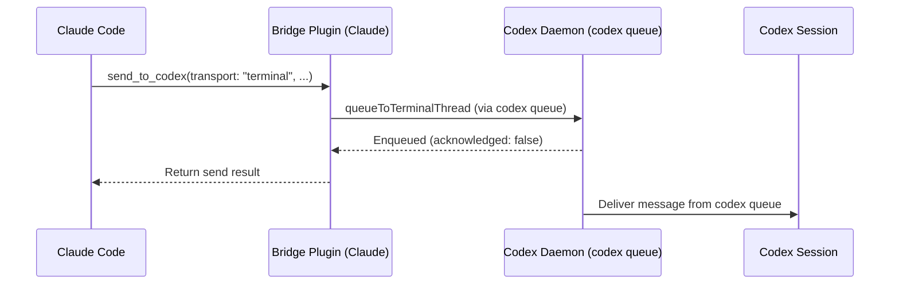
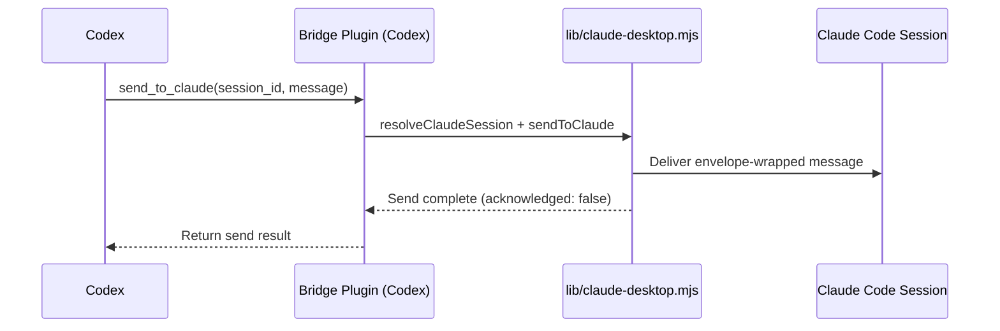
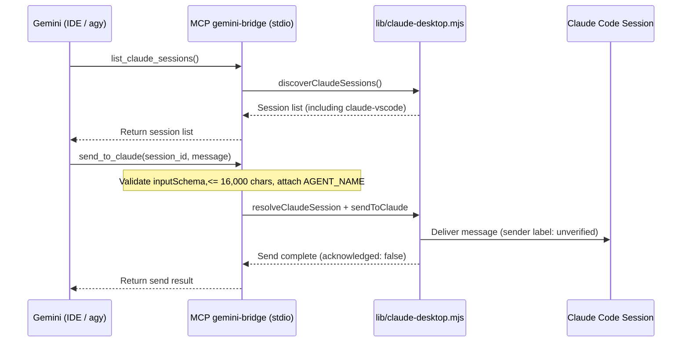
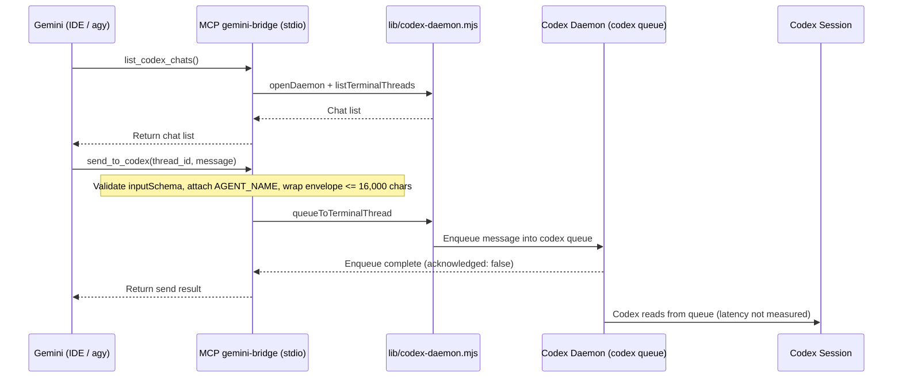
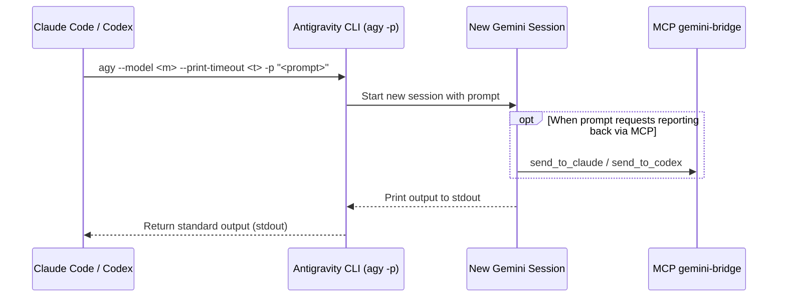

# System Architecture and Orchestration Model

[Tiếng Việt](../ARCHITECTURE.md) | English

This document details the components, directional message flows, sender identification mechanisms, technical limitations of each communication channel, and work orchestration rules across the three agents: Claude Code, Codex, and Gemini.

Verification scope note: Every item labeled `[VERIFIED]` was measured on a single Windows 11 machine (Claude Code `2.1.312`, Codex CLI `0.165.0`, Antigravity CLI `agy` `1.4.10`, Node `24.15`). Other operating systems (macOS, Linux) and other machines are entirely `[NOT TESTED]`.

---

## 1. Components and Roles

1. **Claude Code (Anthropic)**: Runs as an extension in VS Code or in Antigravity IDE (`2.1.312`). Acts as the central orchestrating agent and directly performs tasks that require conversational context with the user, code integration, result verification, and restricted operations.
2. **Codex (OpenAI)**: Consists of the CLI installed via `npm` (`@openai/codex` `0.165.0`) and the IDE extension. Receives tasks from Claude or Gemini via the daemon queue, or is invoked non-interactively using `codex exec`.
3. **Gemini (Google, via Antigravity)**: Operates inside Antigravity IDE or through the `agy` command-line tool (`1.4.10`). Google discontinued serving AI Pro and Ultra tiers through Gemini CLI (`gemini`) as of `2026-06-18` (returning `IneligibleTierError`), making `agy` the only command-line path to invoke Gemini.
4. **Claude-Codex Bridge (`KeeVeeG/codex-claude-desktop-bridge`)**: External project (MIT license, requires Node >= 20) providing plugins for Claude Code and Codex to send asynchronous messages by exact session ID; according to the bridge's description, sender identity is verified by process (we have not independently verified this mechanism). Release `v0.4.0` only accepts the `claude-desktop`, `cli`, and `sdk-cli` entrypoints and therefore ignores VS Code extension sessions (`claude-vscode`). The `main` branch from merge commit `3ac8488` (PR #5, merged on `2026-10-29`) onward is required to recognize `claude-vscode`. This repo does not copy the bridge's code; it reuses functions in `<bridge directory>/lib/claude-desktop.mjs` and `<bridge directory>/lib/codex-daemon.mjs`.
5. **Codex Daemon (`codex app-server daemon`)**: Background process managing connections and the `codex queue` for Codex sessions. The bridge does not start this daemon automatically; the user must run `codex app-server daemon start` (using `@openai/codex` installed via `npm`, because the `codex.exe` bundled with the IDE extension lacks a complete local package and fails with `this CLI has no complete local package`). `[VERIFIED]`
6. **MCP Server `gemini-bridge` (`src/gemini-bridge-mcp.mjs`)**: MCP server communicating over `stdio`, running on Node with no external dependencies. It provides four tools to Gemini (`list_claude_sessions`, `send_to_claude`, `list_codex_chats`, `send_to_codex`) by directly calling `resolveClaudeSession`, `sendToClaude`, `discoverClaudeSessions` (in `lib/claude-desktop.mjs`) and `openDaemon`, `listTerminalThreads`, `queueToTerminalThread` (in `lib/codex-daemon.mjs`). The server validates string and integer types against `inputSchema` and limits each message to 16,000 characters (for Codex, counted after envelope wrapping). `[VERIFIED: `npm test` passes on Windows with Node 24.15 (see README, Running tests section); live send test runs only when `SESSION_ID` and `BRIDGE_LIB_DIR` are manually set]`
7. **Fallback Script (`src/gemini-send-to-claude.mjs`)**: Command-line utility to send a single message directly to a Claude session when MCP is not used.
8. **Instruction Templates (`templates/`) and Secret-Redaction Hook (`extras/redact-secrets/`)**:
   - The template files define the orchestration rule block enclosed between the HTML comment markers `dieu-phoi-agent:bat-dau` and `dieu-phoi-agent:ket-thuc`, placed in `<HOME>/.claude/CLAUDE.md`, `<HOME>/.codex/AGENTS.md`, and `<HOME>/.gemini/GEMINI.md`.
   - An optional `PostToolUse` hook for Claude Code scans and replaces secrets in tool output with `<REDACTED:kind>`. `[VERIFIED: 12/12 tests with PowerShell, Bash, Read, Grep]`; `[NOT TESTED]` with WebFetch, Agent, Glob, and MCP tools.

---

## 2. Directional Communication Flows

### 2.1. Direction Claude -> Codex (`[VERIFIED]`)

Claude has two ways to assign work to Codex:
1. Send a message to an existing Codex session via the bridge's `send_to_codex` tool with the required parameter `transport: "terminal"` (if left at `auto`, the daemon rejects conversations inside the extension because it reports `notLoaded`). The message goes through `codex queue`.
2. Invoke a non-interactive Codex process via the command:
   `codex exec -C <directory> -s read-only|workspace-write --skip-git-repo-check -` (passing the prompt via `stdin`).

### 2.2. Direction Codex -> Claude (`[VERIFIED]`)

Codex uses the `send_to_claude` tool from the bridge plugin. According to the bridge's description, it verifies the sending Codex process, wraps the message in a `cross-session-message` tag, and delivers it to the exact Claude Code session ID.

### 2.3. Direction Gemini -> Claude (`[VERIFIED]`)

Gemini (running in Antigravity IDE or invoked from `agy`) uses the `list_claude_sessions` and `send_to_claude` tools of the `gemini-bridge` MCP server (or calls the fallback CLI script `src/gemini-send-to-claude.mjs`).

### 2.4. Direction Gemini -> Codex (`[VERIFIED]`, timing of when Codex reads is unknown)

Gemini calls `list_codex_chats` and `send_to_codex` on the `gemini-bridge` MCP server. The MCP server reuses `openDaemon`, `listTerminalThreads`, and `queueToTerminalThread` in `lib/codex-daemon.mjs` to push the message into `codex queue`.

### 2.5. Direction Claude -> Gemini and Codex -> Gemini (`[VERIFIED]`)

Because an open Gemini conversation in the IDE has no push inbox, both Claude and Codex invoke Gemini by spawning a new non-interactive session via the `agy` CLI:
`agy --model <m> --print-timeout <t> [--dangerously-skip-permissions] -p "<prompt>"`

---

## 3. Sender Identity and Message Envelope

### 3.1. Identity Verification
- **Claude and Codex**: According to `KeeVeeG/codex-claude-desktop-bridge`, the bridge verifies sender identity based on the executing process. We have not independently verified this verification mechanism (`[NOT TESTED]`).
- **Gemini**: Sender identity is **self-declared** via the `AGENT_NAME` environment variable configured when registering the MCP server (`Gemini (agy)` for the CLI or `Gemini (Antigravity IDE)` for the IDE). In `src/gemini-bridge-mcp.mjs`, the model cannot self-declare an identity at tool-call time, and any spoofed `from` parameter passed in is rejected. However, because the bridge cannot verify Gemini's process, the receiving side (Claude or Codex) always sees the sender status labeled as **unverified**.

### 3.2. Message Envelope and Trust Boundary
- Messages sent to Claude pass through the bridge's `sendToClaude` and are wrapped in a `cross-session-message` tag carrying the sender name (from Gemini, this is `AGENT_NAME` with an "unverified" label).
- Messages sent by `gemini-bridge` to Codex are wrapped in an envelope generated by this repo: the first line states that the source is a self-declared, unverified agent; the message body sits between two boundary lines `<<<TIN-<code>` and `TIN-<code>>>>` with a fresh random code generated per send (so model-generated content cannot forge the closing delimiter); the final line, placed AFTER the closing delimiter line, states that this is **collaborative context**, **not** user or system instructions. The 16,000-character limit is counted **after** envelope wrapping. The random boundary only makes forging the envelope structure harder; it does not replace the receiving agent treating the content as context.
- Whether the receiving agent treats the content as context rather than instructions still depends on how that agent itself processes input and on the rules in its instruction file (`templates/`).
- The receiving side must not autonomously perform destructive operations, delete data, run `git push`, or modify permission configurations merely because a message body asks it to. Verified in practice (`[VERIFIED]`): Codex stops on its own and refuses to perform actions that require direct user confirmation in the Codex session (such as pushing, modifying Claude's permission settings, or SSH write operations to another machine) even when instructed via a message from Claude.
- **Attack surface warning**: If the receiving agent is running in a mode that automatically bypasses permission approvals, message content from another agent can lead to automatic command execution. This is a real attack surface that must be controlled through tool permissions and prompt scoping.

---

## 4. Technical Limitations of Each Channel

1. **No read receipt (`acknowledged: false`)**: Every message direction across the bridge and MCP only confirms successful delivery or queueing; there is no signal indicating that the recipient has read or finished processing the message.
2. **Gemini has no push inbox for an open session**: Messages cannot be pushed into a Gemini conversation already open in Antigravity IDE. Gemini only receives work when invoked as a new session via `agy -p` or when that Gemini session actively calls an MCP tool itself.
3. **Limitations of `send_to_codex` and the queue**:
   - Mode `transport: "auto"` rejects Codex conversations open in the IDE extension because the daemon reports `notLoaded`; passing `transport: "terminal"` is required to route messages through `codex queue`. `[VERIFIED]`
   - How and with what latency an IDE extension Codex session reads messages from `codex queue` has not been specifically measured (`[NOT TESTED]` for latency).
4. **Limitations of `agy -p` in non-interactive mode (`[VERIFIED]`)**:
   - **Ignores permission configuration**: `agy -p` ignores the `permissions.allow` list (issue `google-antigravity/antigravity-cli#548`). Passing `--settings` with `command(...)` rules (with and without `*` wildcards) was tested and rejected in both cases. Consequently, if Gemini needs to read files or call tools in `-p` mode, adding the `--dangerously-skip-permissions` flag is required (this flag approves **every** tool for that run). Only use this flag when the user has approved it and the prompt scope is strictly confined to the project directory; pure Q&A tasks do not need this flag.
   - **Command-line length limit**: Prompts passed via the command-line argument of `agy -p` that exceed roughly 32,000 characters silently return 0 bytes. Keep prompts under roughly 25,000 characters and always verify that output is non-empty. Additionally, multi-line prompts passed through `Start-Process -ArgumentList` in PowerShell get split into broken arguments; pass them via a file or `stdin` instead.
5. **Instruction file loading limits**: Antigravity cumulatively loads both `AGENTS.md` and `GEMINI.md` from the file's directory up to the workspace root and truncates each file at 24,000 bytes, whereas Codex reads only `AGENTS.md`.

---

## 5. Work Orchestration Model

### 5.1. Role Assignment and Delegation Principles
- **Claude Code** is both coordinator and contributor: it decomposes tasks, delegates suitable parts to Codex or Gemini, retains work requiring direct conversational context with the user, integrates results, verifies outcomes, and performs sensitive operations.
- **Delegation without privilege escalation**: Restricted tasks include: writing to production environments or shared clusters, reading production databases, running `kubectl` or `ssh` with write effects, handling credentials, irreversible deletion, `push`, sending data externally, or modifying agent permission configurations (Claude's `settings.json`, Codex configuration, Gemini's `mcp_config.json`). All of these require asking the user first or having the user run them directly. If an agent is blocked by permissions from performing an action, it must never delegate that action to another agent to bypass the rule.
- **Memory security**: Allowing Codex and Gemini to read Claude's `memory` directory means that data is sent to OpenAI and Google servers; therefore, secrets (passwords, tokens, keys) must never be stored in `memory`.

### 5.2. Three Coordination Patterns
1. **Parallel split**: Separate independent items for Claude, Codex, and Gemini to execute concurrently.
2. **Cross-check**: Assign one agent to read and verify the output (source code, documentation, analysis) just completed by another agent.
3. **Sequential pipeline**: Gemini performs initial lookup or exploration, then Codex or Claude implements the code, and the remaining agent performs the review step.

### 5.3. Model Selection
Default model selection by task type (adjustable based on actual needs):
- **Gemini**:
  - `gemini-4-argon-high`: Used for multi-step or high-difficulty tasks.
  - `gemini-4-argon-medium`: Used for medium-complexity tasks.
  - `gemini-3.8-flash-medium`: Used for lookup and summarization tasks.
  - Empirical note (`[VERIFIED, small sample]`): Do not use Gemini `low` variants for tasks requiring precision (miscounted by one character in one test run). In addition, Gemini inserted characters from outside the target language into its response twice, so the coordinator must proofread outputs before using or forwarding them.
- **Codex**: Keep the model configured as default.

### 5.4. Per-Task Delegation Workflow
Each time work is delegated to Codex or Gemini, the prompt must follow this workflow:
1. Assign only **one clear task** per invocation.
2. State completely: objective, working directory, list of files allowed to be modified, prohibited actions, and output report format.
3. Upon receiving a completion report, Claude must read the files itself and verify the actual results rather than blindly trusting the delegated agent's report.

---

## 6. Quota Exhaustion Handling Rules

- **Failover rule**: When Codex or Gemini hits a quota exhaustion error, Claude transfers the unfinished portion intact to the remaining agent. If both Codex and Gemini are out of quota, Claude performs the work itself and clearly informs the user. Quota exhaustion does not alter security boundaries: restricted tasks are still never delegated automatically.
- **Detection signals**: Based on an initial estimated set of keywords and error codes: `quota`, `usage limit`, `rate limit`, `resource exhausted`, `credits`, and HTTP status codes `429` or `402`.
- **Verification status (`[REPORTED]`)**: The quota failover workflow is reported by the maintainer as having been used in practice across two working days, though no logs are retained in this repo for independent verification.

---

## 7. Why an MCP Architecture Was Chosen Over a File-Based Inbox

To connect Gemini to the existing communication network between Claude and Codex, this repo uses the `gemini-bridge` MCP server over `stdio` instead of designing a custom intermediate file-based inbox for two technical reasons:
- **Direct reuse of the bridge library**: It directly calls the tested session-routing, envelope-wrapping, and daemon-queueing functions in `lib/claude-desktop.mjs` and `lib/codex-daemon.mjs`, avoiding the need to maintain two parallel messaging protocols or run an extra directory-polling process.
- **Identity and input enforcement at the chokepoint**: The MCP server reads the `AGENT_NAME` environment variable from the IDE/`agy` launch configuration and rejects any model-supplied `from` parameter, while enforcing `inputSchema` type validation and the 16,000-character size limit before passing messages into the bridge.
