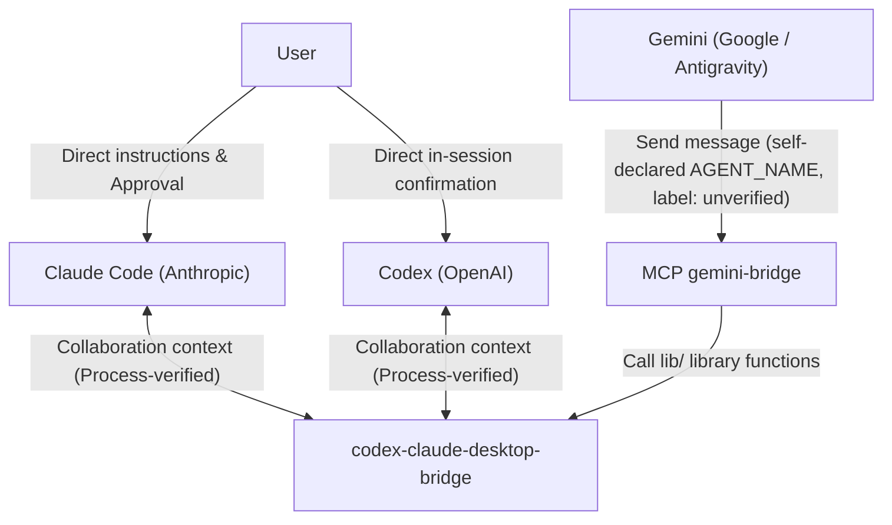

# Security Policy and Model

[Tiếng Việt](../SECURITY.md) | English

This document describes the trust model, attack surface, safety rules for operating `claude-codex-gemini-bridge`, and how to report security vulnerabilities. All practical verification results (`[VERIFIED]`) in this document were performed on Windows 11; other operating systems and environments are currently `[NOT TESTED]`.

## 1. Trust model

### 1.1. Sender identity verification

- Between Claude and Codex: according to the bridge description (`KeeVeeG/codex-claude-desktop-bridge`), sender identity is verified based on the executing process. This is what the bridge claims; this repo has not independently verified that verification mechanism (`[NOT TESTED]`), only verified that messages travel properly in both directions.
- From the Gemini side (`src/gemini-bridge-mcp.mjs`):
  - The sender name is read from the `AGENT_NAME` environment variable set when registering the MCP server. The model cannot self-declare a name when calling a tool, and any forged `from` parameter passed in is rejected (`[VERIFIED]`).
  - However, because `AGENT_NAME` is a self-declared value in the MCP configuration, the bridge cannot verify identity by process; the receiving side always sees the "unverified" label.
- Data constraints in `gemini-bridge`:
  - The maximum message length limit is 16,000 characters (for Codex, this limit is calculated after wrapping the message in its envelope).
  - Input parameters (strings and integers) are strictly validated against `inputSchema` (`[VERIFIED]`: `npm test` passes on Windows with Node 24.15).

### 1.2. Nature of inter-agent messages

- A message received from another agent is collaboration context only, NOT a user instruction or a system instruction. For messages sent by `gemini-bridge` to Codex, the envelope created by this repo states this explicitly in a final sentence placed after the per-send random closing boundary line. For messages sent to Claude, the bridge wraps the message in a `cross-session-message` tag containing the sender name (with an "unverified" label when sent from Gemini); treating that content as a message from another agent rather than from the user is handled by Claude Code itself and is not controlled by this repo.
- The receiving side must not perform destructive actions, delete data, `push`, or modify permission configurations solely because the content of a message requests it.
- In a Codex session, actions that require direct user confirmation (such as `push`, modifying Claude's permission configuration, or SSH writes to another machine) cause Codex to pause and wait for the user; a message from Claude does not replace that confirmation (`[VERIFIED]`).

## 2. Attack surface

- Automatic execution when approval is disabled: Messages sent between agents can lead to automatic command execution if the receiving agent is running in a mode that bypasses permission approval. This is a real attack surface.
- Context-propagated instructions (indirect prompt injection): When an agent reads external content or output from another agent and forwards it through the bridge, malicious content can affect the receiving agent if there are no permission boundaries.
- Self-declared identity on the local MCP channel: Any actor capable of modifying the `AGENT_NAME` variable at MCP startup can set the outgoing sender label (although the receiving side still marks it as "unverified").

## 3. Dangerous flag: --dangerously-skip-permissions

When invoking `agy -p` in non-interactive mode, this CLI ignores the `permissions.allow` configuration (issue `google-antigravity/antigravity-cli#548`). Tests using the `--settings` flag with `command(...)` rules (with and without `*`) were all rejected (`[VERIFIED]`). Therefore, for Gemini to read files or call tools via `agy -p`, the `--dangerously-skip-permissions` flag must be passed.

Risks and mandatory conditions for use:
- Impact: The `--dangerously-skip-permissions` flag automatically approves EVERY tool for that run without prompting the user.
- Use this flag only when the user has approved it.
- Do not use this flag for pure Q&A tasks (pure Q&A does not require the flag).
- Use it only with very narrow prompts that restrict the scope of operation to the project directory.
- Each delegated task must explicitly state the goal, directory, files allowed to be modified, prohibited actions, and report format.
- After the command finishes running, the coordinating agent (Claude) or the user must visually inspect the results themselves rather than trusting Gemini's self-report.

## 4. Restricted actions and delegation principles

Core principle: Delegation does not expand permissions. Sharing work across three agents does not reduce the level of control over sensitive operations.

List of restricted actions:
- Writing to production environments or shared clusters.
- Reading production databases (DB).
- Running `kubectl` or `ssh` commands that perform writes to another machine.
- Handling credentials (passwords, tokens, secret keys).
- Deleting data irreversibly.
- Performing `push` or publishing source code/packages.
- Sending data outside the permitted scope.
- Changing the permission configuration of any agent.

Mandatory rules for restricted actions:
- You must ask the user beforehand or let the user run the action directly.
- Running out of quota does NOT make actions in this restricted group eligible to be delegated to another agent.
- If an agent is blocked by a permission policy, it must stop and report; never hand that task off to another agent to bypass permissions.

## 5. Risks of allowing agents to read memory

- When allowing Codex and Gemini to read Claude's "memory" files (for example, files in a project's memory directory), all read content is transmitted to OpenAI's service (via Codex) and Google's service (via Gemini / Antigravity).
- Data protection rules:
  - Do not place any secrets (passwords, tokens, private keys, sensitive information) in memory.
  - Agents are only permitted to read memory; they must not modify, delete, or rename memory files, and must not copy secrets into messages, logs, or files.

## 6. Role and limitations of the secret-redaction hook

The repo provides an optional component at `extras/redact-secrets/` used as a `PostToolUse` hook for Claude Code:
- Role: Scans tool output and replaces strings matching secret patterns with `<REDACTED:kind>`. The hook is configured to run directly via `command` + `args` (without a shell) with a `timeout` of 15 seconds.
- Tested scope (`[VERIFIED]`): Passes 12/12 automated tests; verified in live runs with the `PowerShell`, `Bash`, `Read`, and `Grep` tools.
- Untested limitations (`[NOT TESTED]`): Not yet tested with `WebFetch`, `Agent`, `Glob`, or MCP tools. Therefore, this is only an additional risk-mitigation layer, not a guaranteed barrier against all secret leaks across all tools.
- Anti-corruption rule: When this hook is active, never write `<REDACTED:...>` strings back into files and never use redacted content to overwrite an entire file.

Secret types recognized by the hook (according to `extras/redact-secrets/redact-secrets.mjs`): PEM private keys (including blocks missing the END line), AWS access keys, GitHub, GitLab, npm, Slack, Stripe, and Telegram bot tokens, Google, OpenAI, and Anthropic API keys, JWTs, Bearer and Basic credentials, passwords in URLs, in JDBC strings, and in `curl -u` or `--user` arguments, values assigned to sensitive key names in text (for example `password=...`, `api_key: ...`), and `data` or `stringData` values of Kubernetes Secrets in YAML or JSON format. Each rule has format, length, or exclusion list conditions, so it is not guaranteed to catch every value in these categories.

Two limitations observed in the code:
- The hook traverses each string value in a tool result without knowing the key name that contains it. If a tool returns an object with a field named `password` whose value is a bare string, that value is not redacted; it is redacted only when the string itself has the form `password=...` or appears inside JSON text. Results from Bash, Read, Grep, and PowerShell are text strings and are less affected; structured results from MCP tools may be affected.
- The hook writes a local log `redact-secrets.log` with the tool name, secret kinds, and redaction counts. The error branch logs only the error type name, not the message content (`JSON.parse` messages can contain a snippet of the input; this was a bug encountered and fixed).

The counting unit for the 16,000-character limit is JavaScript UTF-16 code units (`.length`), not bytes and not Unicode characters: a character outside the Basic Multilingual Plane (such as many emojis) counts as 2.
## 7. Permission configuration recommendations

1. Backup and syntax validation:
   - Every modification to an agent's permission configuration file (Claude's `<HOME>/.claude/settings.json`, Codex's configuration, and Gemini's `<HOME>/.gemini/config/mcp_config.json` and `<HOME>/.gemini/antigravity/mcp_config.json`) must create a backup before editing and validate that the JSON is well-formed before applying.
2. Least privilege:
   - In `<HOME>/.claude/settings.json`, add only the exact rule `mcp__plugin_codex-claude-desktop-bridge_codex-claude-desktop-bridge__send_to_codex` to `permissions.allow`.
   - When invoking Codex non-interactively with `codex exec`, always explicitly specify the working directory via `-C <directory>` and restrict the sandbox with `-s read-only` or `-s workspace-write`.
3. Maintain coordination instruction templates:
   - Place the instruction block from `templates/` into all three files `<HOME>/.claude/CLAUDE.md`, `<HOME>/.codex/AGENTS.md`, and `<HOME>/.gemini/GEMINI.md` so that rules on scope, restricted actions, and cross-verification are always loaded in every project.

## 8. Reporting security vulnerabilities

If you discover a security bug or vulnerability in this repo, please do not open a public issue containing exploit details. Submit a report directly through the GitHub Security Advisories feature of the `claude-codex-gemini-bridge` repo.
