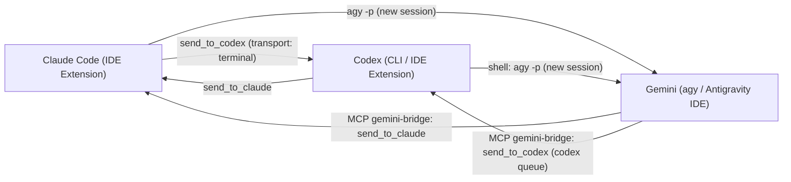

# claude-codex-gemini-bridge Setup Guide

[Tiếng Việt](../SETUP.md) | English

This document explains how to set up a system connecting three locally running coding agents: Claude Code (Anthropic), Codex (OpenAI), and Gemini (Google, via Antigravity). In this model, Claude acts as the coordinator and also works directly on tasks; Codex and Gemini receive assigned tasks or take over forwarded work when another agent runs out of quota.

## Communication Overview



## 1. Prerequisites and Environment Scope

The only configuration tested in practice (`[VERIFIED]`):
- Operating system: Windows 11 (single machine), using PowerShell.
- Node.js: version `24.15` (the bridge requires Node `>= 20`).
- Claude Code: version `2.1.312` (extension running in VS Code and in Antigravity IDE).
- Codex CLI: version `0.165.0` (installed via `npm`, with the IDE extension).
- Antigravity CLI (`agy`): version `1.4.10`.

Warnings about other operating systems and environments:
- macOS, Linux, other Windows machines, and other IDEs are all `[NOT TESTED]`.
- The path to the bridge library in this repo is parameterized (`BRIDGE_LIB_DIR`), but the installation commands below are written for Windows. The upstream bridge claims macOS support over SSH, but that feature is `[NOT TESTED]` within the scope of this document.
- All steps below that use PowerShell commands, Windows-style paths (`~`, `%LOCALAPPDATA%`, `codex.exe`, `agy.exe`), and Task Scheduler have only been performed on Windows and are `[NOT TESTED]` on other operating systems.

## 2. Installing KeeVeeG's Bridge (Claude <-> Codex)

This repo does not contain the Claude-Codex bridge code; instead, it provides installation instructions and reuses functions from the `KeeVeeG/codex-claude-desktop-bridge` repo (MIT license, requires Node `>= 20`).

Notes on the bridge version:
- Version `v0.4.0` only recognizes Claude sessions whose entrypoint is `claude-desktop`, `cli`, or `sdk-cli`, so it ignores VS Code extension sessions (`claude-vscode`).
- The patch adding `claude-vscode` (PR #5) was merged into `main` on 2026-10-29 (merge commit `3ac8488`).
- It is unclear whether any release (tag) includes this patch yet, so you must pull the code from `main` at commit `3ac8488` or later.

### 2.1. Clone the Source and Run Tests

Commands (run on Windows PowerShell; other operating systems `[NOT TESTED]`):

```powershell
git clone https://github.com/KeeVeeG/codex-claude-desktop-bridge <bridge directory>
cd <bridge directory>
```

When running the upstream test suite with `npm test`, set the environment variable `CODEX_CLAUDE_BRIDGE_DAEMON=off` to avoid affecting the live daemon.

- Where it writes: Creates the `<bridge directory>` folder on disk.
- How to undo: Delete the `<bridge directory>` folder.

### 2.2. Codex-Side Installation

Requires a working `codex` command (see Section 3 if `@openai/codex` is not installed yet). From `<bridge directory>`, run:

```powershell
node scripts/install.mjs --codex
```

Verify after installation:

```powershell
codex plugin list
```

The output must include the line `codex-claude-desktop-bridge@personal installed, enabled` (`[VERIFIED]`).

- Where it writes (Windows layout; other operating systems `[NOT TESTED]`):
  - Copies the plugin to `<HOME>\plugins\codex-claude-desktop-bridge` (`~\plugins\codex-claude-desktop-bridge`).
  - Modifies `<HOME>\.agents\plugins\marketplace.json` (`~\.agents\plugins\marketplace.json`); the script automatically creates a backup before modifying it.
  - Executes `codex plugin add codex-claude-desktop-bridge@personal`.
- How to undo:
  - Restore `<HOME>\.agents\plugins\marketplace.json` from the backup created by the script.
  - Delete the `<HOME>\plugins\codex-claude-desktop-bridge` folder.
  - Remove the `codex-claude-desktop-bridge@personal` plugin from the Codex plugin list.

### 2.3. Claude-Side Installation (Manual Install and Permissions)

Step 1: Run the preparation script from `<bridge directory>`:

```powershell
node scripts/install.mjs --claude
```

This script prepares the files and registers the marketplace, but it stops with an error at the `claude plugin install ... --json` step because the `claude` CLI does not have a `--json` option (`[VERIFIED]`).

Step 2: Install the plugin manually:

```powershell
claude plugin install codex-claude-desktop-bridge@codex-claude-desktop-local --scope user
```

Check the plugin list:

```powershell
claude plugin list
```

Step 3: Grant tool permissions in `<HOME>/.claude/settings.json` (`~/.claude/settings.json`):
- Create a backup of `<HOME>/.claude/settings.json` before editing.
- Open `<HOME>/.claude/settings.json` and add the following exact rule to the `permissions.allow` array (equivalent to what the installer's `grantClaudeSendPermission()` function does):

```json
"mcp__plugin_codex-claude-desktop-bridge_codex-claude-desktop-bridge__send_to_codex"
```

- Verify that the JSON syntax is valid before saving the file.

Step 4: Reload plugins:
- Run `/reload-plugins` in the Claude session or open a new Claude session.
- Verify by calling the `list_claude_sessions` and `bridge_doctor` tools (`[VERIFIED]`).

- Where it writes:
  - Claude's marketplace and plugin configuration at `user` scope.
  - `<HOME>/.claude/settings.json`.
- How to undo:
  - Restore `<HOME>/.claude/settings.json` from the backup (or remove the `mcp__plugin_codex-claude-desktop-bridge_codex-claude-desktop-bridge__send_to_codex` rule from `permissions.allow` and re-validate the JSON).
  - Uninstall the `codex-claude-desktop-bridge@codex-claude-desktop-local` plugin from Claude, then run `/reload-plugins` or open a new session.

### 2.4. Bridge Environment Variables

- `CODEX_CLAUDE_BRIDGE_CODEX_BIN`: Direct path to the `codex.exe` executable if it is not in `PATH` (the `.exe` filename is Windows-specific; other operating systems `[NOT TESTED]`).
- `CODEX_CLAUDE_BRIDGE_DAEMON=off`: Disables use of the daemon and queue.
- `CODEX_CLAUDE_BRIDGE_STATE_DIR`: Directory where the bridge stores its state.

## 3. Installing Codex CLI and Starting the Daemon

The `codex.exe` bundled with the IDE extension does not include a complete local package to run the daemon (it fails with `this CLI has no complete local package`). You must install the `@openai/codex` package via `npm` (`[VERIFIED]`).

### 3.1. Manual Installation and Startup

```powershell
npm i -g @openai/codex
codex app-server daemon start
codex app-server daemon version
```

The bridge does not auto-start the Codex daemon, so the daemon must be started before communicating (`[VERIFIED]`).

### 3.2. Auto-Start on Logon

On Windows (other operating systems `[NOT TESTED]`):
- Create a task in Task Scheduler to run `codex app-server daemon start` whenever the user logs on.

- Where it writes:
  - The `npm` global package installation directory (`global`).
  - The Codex daemon background process.
  - The Windows Task Scheduler task database.
- How to undo:
  - Delete the auto-start task in Task Scheduler.
  - Stop the Codex daemon process.
  - Uninstall the global `@openai/codex` package using `npm`.

## 4. Installing Antigravity CLI (agy)

Starting 2026-06-18, Google stopped serving AI Pro and Ultra tiers through the Gemini CLI (`gemini`) and returns `IneligibleTierError`, requiring a switch to Antigravity CLI (`agy`) (`[VERIFIED]`).

Safety recommendation before installing:
- You should download the script from `https://antigravity.google/cli/install.ps1` and inspect its contents before executing it. This script downloads the binary from Google's update service, verifies its SHA512 hash, copies `agy.exe` to `%LOCALAPPDATA%\agy\bin`, and adds that directory to the user's `PATH` variable.

Installation command on Windows PowerShell (Windows only; other operating systems `[NOT TESTED]`):

```powershell
irm https://antigravity.google/cli/install.ps1 | iex
```

Verify after installation:

```powershell
agy --version
agy models
```

- Where it writes (on Windows; other operating systems `[NOT TESTED]`):
  - Executable file `%LOCALAPPDATA%\agy\bin\agy.exe`.
  - User-level `PATH` environment variable (User PATH).
- How to undo:
  - Delete the `%LOCALAPPDATA%\agy\bin` directory (or the entire `%LOCALAPPDATA%\agy` directory).
  - Remove `%LOCALAPPDATA%\agy\bin` from the user-level `PATH` variable.

## 5. Cloning This Repo and Registering the gemini-bridge MCP Server

### 5.1. Clone the claude-codex-gemini-bridge Repo

Clone this repo into `<repo directory>` and run the test suite (no package installation needed):

```powershell
git clone https://github.com/XXLC/claude-codex-gemini-bridge <repo directory>
cd <repo directory>
npm test
```

If you place KeeVeeG's bridge directory right next to this repo directory under the name `codex-claude-desktop-bridge`, the code finds its `lib/` automatically. If you place it elsewhere, or want to be explicit, set `BRIDGE_LIB_DIR` to point to the bridge's `lib` directory (see usage in steps 5.2 and 5.3). Once `BRIDGE_LIB_DIR` is set, the sibling directory is no longer used as a fallback. The code selects only one directory (the environment variable if set, otherwise the sibling directory). If the selected directory does not exist, the message-sending tools return a Vietnamese error stating both the `BRIDGE_LIB_DIR` value and the sibling directory path, along with instructions on how to set the variable.

Main components in the repo:
- `src/gemini-bridge-mcp.mjs`: An MCP server communicating over `stdio`, written in Node with no external dependencies. Provides Gemini with 4 tools: `list_claude_sessions`, `send_to_claude`, `list_codex_chats`, `send_to_codex`. This file reuses functions from the bridge's `lib` directory (`resolveClaudeSession`, `sendToClaude`, `discoverClaudeSessions` in `lib/claude-desktop.mjs`; `openDaemon`, `listTerminalThreads`, `queueToTerminalThread` in `lib/codex-daemon.mjs`) via the `BRIDGE_LIB_DIR` environment variable. (`[VERIFIED: `npm test` passes on Windows with Node 24.15 (see README, Running tests section); the live send case only runs when `SESSION_ID` and `BRIDGE_LIB_DIR` are set manually]`).
- `src/gemini-send-to-claude.mjs`: Fallback CLI script to send a message to a Claude session when not using MCP.

- Where it writes: The `<repo directory>` folder.
- How to undo: Delete the `<repo directory>` folder.

### 5.2. Register gemini-bridge MCP for agy

Run the following command (note that the `-e` flags must be placed before the name `gemini-bridge`; the `codex.exe` filename is Windows-specific, other operating systems `[NOT TESTED]`):

```powershell
agy mcp add -e "AGENT_NAME=Gemini (agy)" -e "CODEX_CLAUDE_BRIDGE_CODEX_BIN=<path to codex.exe>" -e "BRIDGE_LIB_DIR=<bridge lib directory>" gemini-bridge <path to node> <path to gemini-bridge-mcp.mjs>
```

Verify registration:

```powershell
agy mcp list
```

Restart `agy` to load the new configuration.

- Where it writes: `<HOME>/.gemini/config/mcp_config.json` (`~/.gemini/config/mcp_config.json`).
- How to undo: Back up `<HOME>/.gemini/config/mcp_config.json`, open the file and remove the `gemini-bridge` configuration entry, verify that the JSON is valid, and save.

### 5.3. Register gemini-bridge MCP for Antigravity IDE

Step 1: Create a backup of `<HOME>/.gemini/antigravity/mcp_config.json` (`~/.gemini/antigravity/mcp_config.json`).

Step 2: Open `<HOME>/.gemini/antigravity/mcp_config.json` and add the `mcpServers.gemini-bridge` key with `command`, `args`, and `env` fields similar to the `agy` configuration, but set `AGENT_NAME` to `Gemini (Antigravity IDE)`:

```json
{
  "mcpServers": {
    "gemini-bridge": {
      "command": "<path to node>",
      "args": [
        "<path to gemini-bridge-mcp.mjs>"
      ],
      "env": {
        "AGENT_NAME": "Gemini (Antigravity IDE)",
        "CODEX_CLAUDE_BRIDGE_CODEX_BIN": "<path to codex.exe>",
        "BRIDGE_LIB_DIR": "<bridge lib directory>"
      }
    }
  }
}
```

(The `<path to codex.exe>` value is Windows-specific; other operating systems `[NOT TESTED]`).

Step 3: Verify that the JSON file is valid after saving, then restart Antigravity IDE to load the MCP server.

- Where it writes: `<HOME>/.gemini/antigravity/mcp_config.json`.
- How to undo: Restore `<HOME>/.gemini/antigravity/mcp_config.json` from the backup (or remove the `mcpServers.gemini-bridge` key and verify that the JSON is valid), then restart Antigravity IDE.

## 6. Placing Instruction Templates from templates/ into the Three User-Level Configuration Files

The `templates/` directory contains the "agent coordination" instruction block enclosed between the HTML comment lines `<!-- dieu-phoi-agent:bat-dau -->` and `<!-- dieu-phoi-agent:ket-thuc -->` to apply across all of the user's projects.

How each tool reads its configuration:
- Claude reads `<HOME>/.claude/CLAUDE.md` (`~/.claude/CLAUDE.md`).
- Codex only reads `AGENTS.md`, located at `<HOME>/.codex/AGENTS.md` (`~/.codex/AGENTS.md`).
- Antigravity cumulatively loads both `AGENTS.md` and `GEMINI.md` from the directory containing the currently open file up to the workspace root and truncates each file at 24,000 bytes; the user-level file is located at `<HOME>/.gemini/GEMINI.md` (`~/.gemini/GEMINI.md`).

Steps to perform:
1. Back up `<HOME>/.claude/CLAUDE.md`, `<HOME>/.codex/AGENTS.md`, and `<HOME>/.gemini/GEMINI.md` if they already exist.
2. Copy the content block between `<!-- dieu-phoi-agent:bat-dau -->` and `<!-- dieu-phoi-agent:ket-thuc -->` from the template files in `templates/` into the three corresponding target files.
3. In the copied content, find and replace all placeholder paths (such as `<HOME>`, `<bridge directory>`, `<path to codex.exe>`) with the actual paths on your machine.

- Where it writes:
  - `<HOME>/.claude/CLAUDE.md`
  - `<HOME>/.codex/AGENTS.md`
  - `<HOME>/.gemini/GEMINI.md`
- How to undo: Restore the three files above from their backups, or delete the text from the `<!-- dieu-phoi-agent:bat-dau -->` line through the `<!-- dieu-phoi-agent:ket-thuc -->` line in each file.

## 7. Installing the Secret Redaction Hook (OPTIONAL)

This component is OPTIONAL; its source code is in `extras/redact-secrets/`.

Functionality and tested scope:
- This is a Claude Code `PostToolUse` hook that replaces secrets appearing in tool output with the string `<REDACTED:kind>`.
- Tested status: `[VERIFIED]` 12/12 automated tests; live-tested with the `PowerShell`, `Bash`, `Read`, and `Grep` tools.
- Untested status: `[NOT TESTED]` with the `WebFetch`, `Agent`, and `Glob` tools, as well as MCP tools.

Installation steps:
1. Back up `<HOME>/.claude/settings.json` (`~/.claude/settings.json`) before editing.
2. Open `<HOME>/.claude/settings.json` and add the configuration to the `hooks.PostToolUse` block with `matcher: "*"`, using a `command`-type hook combined with `args` (invoked directly without a shell) pointing to the script in `extras/redact-secrets/`, and set `timeout` to `15`. If the file already has a `hooks` key, merge into it instead of creating a second key:

```json
"hooks": {
  "PostToolUse": [
    {
      "matcher": "*",
      "hooks": [
        {
          "type": "command",
          "command": "<path to node>",
          "args": ["<repo directory>/extras/redact-secrets/redact-secrets.mjs"],
          "timeout": 15
        }
      ]
    }
  ]
}
```
3. Verify that the JSON is valid after saving.

Mandatory safety rules when the hook is enabled:
- Do not write `<REDACTED:...>` strings back into files.
- Do not use redacted content to overwrite an entire file.

- Where it writes: `<HOME>/.claude/settings.json`.
- How to undo: Restore `<HOME>/.claude/settings.json` from the backup, or remove the hook configuration under `hooks.PostToolUse` and re-validate the JSON syntax.

## 8. VERIFICATION

The table below lists each communication direction and how to test it (all CLI commands were tested on Windows PowerShell; other operating systems `[NOT TESTED]`):

| Direction | Method and Verification Command | Status |
|---|---|---|
| Claude -> Codex | In a Claude session, call the bridge's `send_to_codex` tool with `transport: "terminal"` required. Alternatively, invoke Codex non-interactively via: `codex exec -C <directory> -s read-only\|workspace-write --skip-git-repo-check -` (pass the prompt via `stdin`). | `[VERIFIED]` |
| Codex -> Claude | In a Codex session, call the bridge's `send_to_claude` tool (use `list_claude_sessions` to get the session ID). | `[VERIFIED]` |
| Gemini -> Claude | In a Gemini session, call `list_claude_sessions` and then `send_to_claude` from the `gemini-bridge` MCP server. When not using MCP, run the fallback script: `node <repo directory>/src/gemini-send-to-claude.mjs --to <session_id> --message "<message>"` (or pass the message via stdin, terminated by EOF). The sender name is read from `AGENT_NAME`; the script has no `--from` option. `<session_id>` comes from `list_claude_sessions`. | `[VERIFIED]` |
| Gemini -> Codex | In a Gemini session, call `list_codex_chats` and then `send_to_codex` from the `gemini-bridge` MCP server (messages go through `codex queue`). | `[VERIFIED]` (unclear when the Codex side reads the queue; latency in the extension has not been measured) |
| Claude -> Gemini | From Claude, run a command to open a new Gemini session: `agy --model <m> --print-timeout <t> [--dangerously-skip-permissions] -p $prompt` (or `-p "<prompt>"`). | `[VERIFIED]` |
| Codex -> Gemini | From Codex, run a shell command: `agy --model <m> --print-timeout <t> [--dangerously-skip-permissions] -p $prompt` (or `-p "<prompt>"`). | `[VERIFIED]` |

Verification notes:
- None of the communication directions provide read receipts (`acknowledged: false`).
- An already-open Gemini conversation in the IDE has no inbox for pushed messages; Gemini only receives work when invoked via `agy -p` (opening a new session) or when it actively calls an MCP tool.
